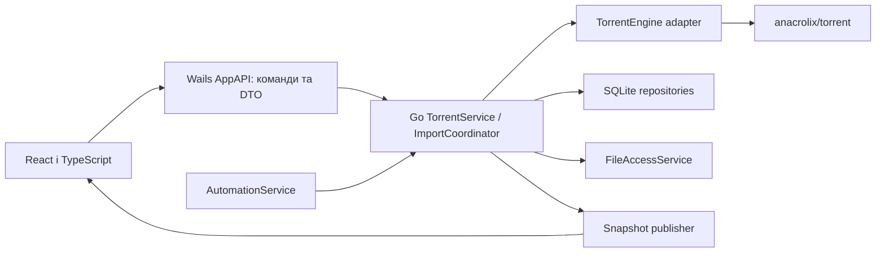

# OctopusTorrent — архітектура React/TypeScript + Wails + Go

**Статус:** обраний стек, 14 жовтня 2026 року. Ціль — особистий desktop-застосунок для macOS, спочатку власний Apple Silicon Mac. Критерії поведінки містить `PROJECT_REQUIREMENTS.md`; відповідність API рушія — `ANACROLIX_TORRENT_TECHNICAL_RESEARCH.md`.

## 1. Стек і межа системи

| Частина | Рішення |
|---|---|
| UI | React + TypeScript у strict mode; Vite для frontend-збірки. |
| Desktop оболонка | Стабільна гілка Wails v2; точний patch-реліз фіксується після пробної збірки. |
| Логіка й доступ до файлів | Go, стандартні контексти скасування та явно керовані goroutines. |
| Рушій | github.com/anacrolix/torrent, ізольований адаптером власного інтерфейсу. |
| Локальна бібліотека | SQLite через Go repository; драйвер перевіряється й фіксується у прототипі. |

Готова `.app` містить локальні frontend assets і Go-застосунок. UI працює в системному WebView; виклики Go й події проходять через Wails. Wails підтримує генерацію bindings і TS-моделей. [Wails: будова застосунку](https://wails.io/docs/howdoesitwork/).

Власного віддаленого сервера, акаунтів, оплат, ліцензійного API, хмарної синхронізації та продуктової аналітики немає. Інтернет потрібен для BitTorrent. Go/Node.js/Wails CLI — інструменти розробки; готовий застосунок перевіряється як самодостатній пакет на цільовому Mac. Native залежності Wails і обраного storage/transport, включно з вимогами CGO, враховуються у збірці.

## 2. Компоненти й напрямки залежностей



| Компонент | Відповідальність |
|---|---|
| React Views | Картки, інспектор, дерева, модалки, груповий вибір, алерти та налаштування. |
| Frontend bridge adapter | Єдина точка виклику generated bindings і підписок на події; тестовий адаптер для browser-тестів. |
| AppAPI | Вузький Wails facade: прийняти запит, перевірити DTO, делегувати й повернути результат/operation ID. |
| TorrentService | Політика паузи/віддачі/wanted, порядок команд, відповідність записів UUID об’єктам рушія. |
| TorrentEngine | Власний контракт над anacrolix/torrent, перетворення фактичного стану й помилок на DTO. |
| ImportCoordinator | Валідація, дедуплікація, pending previews, підтвердження та скасування всіх способів імпорту. |
| LibraryRepository | SQLite-схеми, міграції, транзакції, торренти, файли, налаштування, теги, колекції й правила. |
| FileAccessService | Системний вибір, створення папок, нормалізація, колізії, перевірка доступу й явне видалення. |
| AutomationService | Watch folder і правила, що використовують той самий ImportCoordinator. |
| SnapshotPublisher | Узгоджені знімки з ревізіями, агрегування частих змін і відновлення після пропуску події. |
| LocalDiagnostics | Коди, ID операцій і причини проблем; автоматичного надсилання немає. |

Один довгоживучий torrent.Client обслуговує бібліотеку. Об’єкти рушія використовуються лише в Go adapter. Frontend не має filesystem/engine API і не визначає успіх запису даних самостійно.

## 3. Структура репозиторію для AI-first

Це погоджена карта майбутнього кодового репозиторію, а не опис уже створених файлів:

```text
main.go / wails.json             запуск і конфігурація оболонки
go.mod / go.sum                 Go toolchain і залежності
internal/app/                   facade, lifecycle, координація команд
internal/torrentengine/         інтерфейс і anacrolix adapter
internal/library/               SQLite repositories і migrations
internal/files/                 доступ, шляхи, папки, видалення
internal/automation/            правила й watch folder
internal/platform/              Wails runtime, Finder, URL, системні діалоги
internal/diagnostics/            локальні помилки й журнали
frontend/src/features/          UI за функціями
frontend/src/bridge/            власний адаптер generated bindings
frontend/src/state/             snapshots і презентаційний стан
frontend/src/i18n/              словники шести мов
frontend/src/styles/            кольори, відступи, теми й матеріали
frontend/wailsjs/               bindings, згенеровані Wails v2
frontend/package.json / lockfile
scripts/                        відтворювані build/check-команди
docs/README.md                  індекс актуальної документації
docs/engineering/               TDD, 100% покриття, правила роботи
docs/features/                  поведінка й реалізація кожної фічі
docs/decisions/                 важливі вибори та їхні причини
docs/verification/              докази тестів, покриття й аналізу
README.md / AGENTS.md            карта проєкту й інструкції агенту
```

Модулі й методи мають предметні англійські назви. Власний bridge adapter відділяє React від конкретних generated шляхів; генерований код не редагується вручну. Сервіси отримують залежності явно; їхні unit-тести не запускають Wails-вікно. Новий АІ-агент має знайти сценарій від UI до Go/рушія лише за репозиторієм. Обов’язкові критерії AI-01–AI-10 містить розділ 5.2 вимог.

## 4. Контракт Go–TypeScript

Методи facade групуються за задачами: отримати бібліотеку/налаштування, підготувати імпорт, підтвердити/скасувати його, запустити/зупинити записи, змінити wanted файла/папки, виконати видалення, змінити налаштування, колекції та правила. Це власний API продукту; його назви не зобов’язані повторювати API бібліотеки.

Запит містить UUID або pendingImportID, конкретні параметри й operationID для нетривіалих мутацій. Відповідь відрізняє прийняту операцію від завершеної. `AppError` має стабільний code, operationID, torrentID за потреби та параметри для локалізації. Технічний error не показується як перекладений користувацький текст автоматично.

`TorrentSnapshot` містить UUID, revision, фактичний статус, ручну паузу, wanted-обсяг, завершені байти, швидкості в bytes/sec, кількість peers, ETA за наявності, файли та помилки. Через bridge передаються власні структури з JSON-полями й одиницями; не pointers, channels або об’єкти рушія. Інтеграційний тест перевіряє точність великих чисел; значення поза безпечним числовим діапазоном TS передаються узгодженим десятковим рядком.

Кожен запуск Go має тимчасовий `runtimeID`; ревізії порівнюються лише всередині нього. Це ідентичність поточного виконання в пам’яті, а не ідентифікатор установки або аналітика. Нове підключення підтверджує свій актуальний повний стан; пізні відповіді попереднього підключення не можуть його замінити. Повний знімок може пропускати номери через об’єднання оновлень; для часткової події перевіряється її базова ревізія. Результат нетривіалої операції доступний повторним запитом, навіть якщо подію завершення втрачено.

Frontend спочатку підписується, потім отримує повний snapshot; revision відкидає застарілі події. Після порушення базової ревізії часткових подій, зміни runtime або remount отримується новий повний snapshot. React effect очищає listener; frontend reload не створює ще одного torrent.Client. Wails має emit/listener API; правила ревізій і відновлення є нашою логікою. [Wails Events](https://wails.io/docs/reference/runtime/events/).

Snapshot publisher агрегує часті зміни. Початкова частота вимірюється на прототипі; важливі стани й помилки не губляться при агрегуванні. Browser `navigator.onLine` не вважається доказом доступності tracker або peers.

## 5. Потоки виконання й політики

Wails lifecycle запускає Go-компоненти й задає контекст завершення. Довгі операції мають власний context, cancellation і контроль завершення; goroutines не залишаються після Drop/quit. Команди, що змінюють один торрент, серіалізуються. Паралельний імпорт і snapshot-читання не повинні дублювати записи або створювати data race.

Збережена політика відокремлена від фактичного стану:

- `manualPaused` забороняє payload в обох напрямках;
- `globalUploadDisabled` забороняє тільки віддачу;
- file wanted/priority визначає цільове завантаження;
- помилка доступу або видалення має власний стан і не змінює ручну паузу мовчки.

Ефективний дозвіл віддачі обчислюється з усіх цих умов. Вимкнення globalUploadDisabled не запускає manualPaused. Збереження бажаного стану в SQLite й застосування до engine мають видимий результат: якщо engine або запис БД не спрацювали, UI показує незавершеність/помилку. При перезапуску політика застосовується до дозволу payload.

Для завершеного торрента текст «Завершено» й «Роздається» залежить від готовності вибраних даних і політики; `Seeding()` не використовується як єдине джерело статусу. Перевірка, metadata waiting, filesystem error й ручна пауза мають пріоритетні правила відображення.

## 6. SQLite та відновлення

| Сутність | Дані |
|---|---|
| TorrentRecord | UUID, повні необов’язкові v1/v2 infohash, metainfo/magnet, назва, джерело, дата, save path, manualPaused. |
| FileSelection | UUID, file index і перевірений відносний шлях, wanted, попередній пріоритет. |
| Tags / Collections | ID, назви, зв’язки й визначення локальних фільтрів. |
| ImportRules / Preferences | Умови, порядок, local paths, тема, мова, ліміти, глобальна віддача, watch folder і явне auto-add. |
| Operations | Нетривіальна операція, її стан і результат; потрібна для відновлення перерваного імпорту/видалення. |

Застосунок використовує явні SQL-міграції й транзакції через repository. Драйвер обирається за збіркою на Mac, конкурентністю та вимогами CGO і фіксується в Go module. Payload лежить у вибраній папці; бібліотека й внутрішні дані engine — у data directory застосунку.

Piece completion належить storage backend рушія й не замінює власну SQLite-бібліотеку. Його базу не редагує React або repository продукту. Наші manualPaused/wanted зберігаються й відновлюються явно через SQLite repository. Чужі або застарілі completion-ознаки не замінюють перевірку фактичних файлів.

При запуску: відкрити й мігрувати БД → завантажити записи → перевірити папки → додати їх із забороненим payload → відновити wanted і глобальну політику → дозволити передавання лише потрібним записам. Відсутня папка дає помилку й вибір нового розташування, а не новий download у випадкову папку. Аварія перевіряється окремо від звичайного quit.

## 7. Імпорт, metadata і вибір файлів

Кнопка, drag-and-drop, Finder, magnet і watch folder входять через ImportCoordinator. Перед створенням library record перевіряються кількість/формат, межі метаданих, шляхи, symlink, колізії й повні v1/v2 ідентичності. Імпорт підтверджується транзакційно; повторне джерело відкриває вже наявний запис.

`.torrent` можна розібрати до активного engine-запису. Для magnet потрібен pending metadata-only сценарій без payload і нескінченної goroutine очікування. Тимчасова папка належить конкретному pendingImportID. На підтвердженні створюється запис із остаточним storage й папкою; не припускаємо, що зміну storage можна виконати звичайним MergeSpec. Скасування очищає лише відомі тимчасові артефакти й закриває pending engine object. Цей процес перевіряється до реалізації всіх екранів.

UI будує дерево з перевірених шляхів. До додавання файли/папки вибираються чекбоксами; після додавання play/pause змінює wanted. Pause папки виключає всі нащадки, play за часткового стану вибирає все; згортання не змінює політику. Рядок дитини зсунений праворуч разом із кнопкою й прогресом.

Пропуск файла не видаляє байти і не є незалежною зупинкою його віддачі. Shared pieces враховуються при тестуванні. Зміна пріоритету не змінює ручну паузу торрента.

## 8. Файли й безпечне видалення

Системні file/directory dialogs викликає platform adapter; Go повторно перевіряє отриманий шлях. Створення папки — явна дія з назвою й батьківським каталогом. Зміна типової папки впливає тільки на майбутні імпорти. Для окремого торрента storage створюється з його save path; один глобальний DataDir не підмінює індивідуальні папки.

Видалення запису спершу зберігає намір операції, припиняє payload і вилучає torrent із client. Далі режими розділяються: `record_only` фіналізує видалення library record; `with_files` лишає його зупиненим до завершення перевірених файлових дій. Спільна підготовка не викликає передчасну фіналізацію першого режиму. Видалення даних додатково потребує переліку й підтвердження. Go перевіряє кожний фізичний шлях, спільні файли, symlink і сторонній вміст. `Drop()` не використовується як команда видалення файлів.

Файлова система й SQLite не утворюють спільної транзакції. Нетривіальне видалення записує intent/стан операції; після аварії відновлюється або показується частковий результат. Якщо payload не вдалося перемістити в Смітник, запис лишається зупиненим із зрозумілою помилкою. Аварія після фізичного переміщення, але до запису результату, створює явно невизначений результат до узгодження журналу й файлів; сама відсутність файла не доводить успіх. Конкретний механізм macOS Trash треба перевірити; видалення назавжди не видається за переміщення в Смітник. Для bulk delete результат відстежується по кожному UUID.

## 9. macOS та frontend

Wails platform adapter обробляє відкриття файла/URL. Якщо UI ще не готовий, джерело потрапляє в pending queue; після готовності відкривається звичайний preview, а не автоматичне payload-завантаження. Пакет `.app` реєструє `.torrent` і magnet, default association визначає користувач. Перевіряються холодний запуск, уже відкрита `.app` і дублікати. [Wails Options](https://wails.io/docs/reference/options/), [Wails Dialog](https://wails.io/docs/reference/runtime/dialog/).

HTML-макет є візуальним і поведінковим орієнтиром, а не production-сервісом. React переносить його розміщення й стилі в компоненти. Семантичний HTML, фокус, keyboard, VoiceOver, світла/темна тема та контраст тестуються у macOS WebView. Скляні панелі реалізуються React/CSS із непрозорим fallback.

Словники шести мов живуть у frontend. Go повертає стабільні коди помилок із параметрами. Реальні назви й шляхи не перекладаються; full path доступний у tooltip, accessibility label і копіюванні.

## 10. Перевірки й етапи

1. Зафіксувати toolchain і зробити Wails `.app` на власному Mac; встановити однозначні build/check-команди.
2. Прототип anacrolix/torrent: `.torrent`, magnet, payload, пауза, file priorities, глобальна віддача, різні папки, перезапуск і Drop без видалення даних.
3. Repository/міграції, AppAPI, snapshots і React UI з тестовим engine/bridge.
4. Реальна інтеграція, алерти, файлові операції, великі дерева й групові дії.
5. Теги, колекції, правила й watch folder.

Go-тести перевіряють сервісні інваріанти, SQLite і контрольований swarm. React component/browser-тести перевіряють UI через fake bridge; WebKit-тест допомагає виявити відмінності від Chromium. Окремий smoke test запускає фактичну `.app` із Finder/діалогами/quit. Race detector, скасування subscriptions і завершення goroutines є перевірками реальних конкурентних ризиків. Невиконаний тест не позначається успішним.

## 11. Обов’язкові інваріанти розробки

Перед кожною сесією агент перевіряє цю архітектуру проти фактичного коду й планує зміну з явними власниками стану, залежностями, побічними ефектами, помилками та повторним використанням. Висновок і план записуються до редагування; зміна контракту актуалізує цей документ/ADR одразу.

Усі модулі та прототипи розробляються через RED → GREEN → REFACTOR. Власний виконуваний код, включно з точками запуску, інструментами й системними адаптерами, досягає 100% визначених метрик; окремі приклади або тільки нові рядки не замінюють повний інвентар. Тестопридатні межі створюються явним передаванням залежностей; складну логіку не виключають із вимірювання.

Спільні UI-компоненти/hooks, політики Go, репозиторії та адаптери перевикористовуються за відповідальністю. Бізнес-правило не реалізується окремо в React і Go. Рефакторинг зачепленого сценарію виконується на зелених тестах у поточній задачі; незавершений обхід або технічний борг блокує її завершення.

Поведінка й фактичні модулі фічі підтримуються в `docs/features/`, рішення — у `docs/decisions/`, перевірки — у `docs/verification/`. Вимоги [QA-01–QA-08](PROJECT_REQUIREMENTS.md) та [TDD_AND_QUALITY.md](docs/engineering/TDD_AND_QUALITY.md) визначають обов’язкові умови; [AGENTS.md](AGENTS.md) застосовує їх у кожній сесії.
