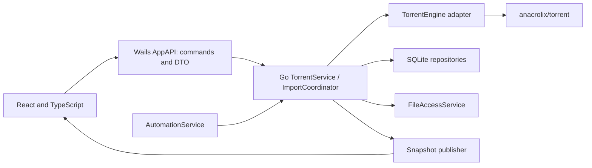

# OctopusTorrent — React/TypeScript + Wails + Go architecture

**Status:** chosen stack, 14 October 2026. The target is a personal desktop application for macOS, initially the owner's own Apple Silicon Mac. Behavior criteria are in `PROJECT_REQUIREMENTS.md`; mapping to the engine API is in `ANACROLIX_TORRENT_TECHNICAL_RESEARCH.md`.

## 1. Stack and system boundary

| Part | Decision |
|---|---|
| UI | React + TypeScript in strict mode; Vite for the frontend build. |
| Desktop shell | Stable Wails v2 branch; the exact patch release is pinned after a trial build. |
| Logic and file access | Go, standard cancellation contexts and explicitly managed goroutines. |
| Engine | github.com/anacrolix/torrent, isolated behind an adapter of our own interface. |
| Local library | SQLite through a Go repository; the driver is verified and pinned in the prototype. |

The finished `.app` contains local frontend assets and the Go application. The UI runs in the system WebView; Go calls and events go through Wails. Wails supports generating bindings and TS models. [Wails: how the application works](https://wails.io/docs/howdoesitwork/).

There is no own remote server, accounts, payments, licensing API, cloud sync or product analytics. Internet is needed for BitTorrent. Go/Node.js/Wails CLI are development tools; the finished application is verified as a self-contained package on the target Mac. Native dependencies of Wails and the chosen storage/transport, including CGO requirements, are accounted for in the build.

## 2. Components and dependency directions



| Component | Responsibility |
|---|---|
| React Views | Cards, inspector, trees, modals, bulk selection, alerts and settings. |
| Frontend bridge adapter | The single call point for generated bindings and event subscriptions; a test adapter for browser tests. |
| AppAPI | A narrow Wails facade: accept a request, validate the DTO, delegate and return a result/operation ID. |
| TorrentService | Pause/upload/wanted policy, command order, mapping of record UUIDs to engine objects. |
| TorrentEngine | Our own contract over anacrolix/torrent, converting actual state and errors into DTOs. |
| ImportCoordinator | Validation, deduplication, pending previews, confirmation and cancellation for all import methods. |
| LibraryRepository | SQLite schemas, migrations, transactions, torrents, files, settings, tags, collections and rules. |
| FileAccessService | System picker, folder creation, normalization, collisions, access checks and explicit deletion. |
| AutomationService | Watch folder and rules that use the same ImportCoordinator. |
| SnapshotPublisher | Consistent snapshots with revisions, aggregation of frequent changes and recovery after a missed event. |
| LocalDiagnostics | Codes, operation IDs and causes of problems; there is no automatic sending. |

One long-lived torrent.Client serves the library. Engine objects are used only in the Go adapter. The frontend has no filesystem/engine API and does not decide on its own whether a data write succeeded.

## 3. Repository structure for AI-first

This is the agreed map of the future code repository, not a description of files that already exist:

```text
main.go / wails.json             shell startup and configuration
go.mod / go.sum                 Go toolchain and dependencies
internal/app/                   facade, lifecycle, command coordination
internal/app/contracts/         bridge DTOs, AppError, strict requests, shared examples (exists, 005)
internal/app/operations/        idempotent operation ledger (exists, 005)
internal/torrentengine/         interface and anacrolix adapter
internal/torrentengine/testutil/ fixture (own v1/v2/hybrid test torrents), swarm (closed loopback swarm) (exists, 006)
internal/torrentengine/          engine contract tests on the pinned version (exist, 007); the adapter comes in 018
internal/torrentengine/transferswitch/  confirmed upload stop, resume without a stall, the writer wake bound (prototype from 010; 018 moves it into the adapter)
cmd/engine-spike/, internal/enginespike/, frontend/src/spike/   temporary EngineSpike.app (exists, 007; deleted by 034)
internal/library/               SQLite: Open/Write/Read and error kinds (008), the piece-completion marks (009); repositories and migrations
internal/torrentengine/filestore/   the engine storage: guard, marks completion, session record (prototype from 009; 018 builds on it)
internal/torrentengine/classicio/   restarts the process with classic file IO (009)
internal/files/                 the rehash rule and file fingerprints (009); access, paths, folders, deletion
internal/automation/            rules and watch folder
internal/platform/              Wails runtime, Finder, URL, system dialogs
internal/diagnostics/            local errors and logs
frontend/src/features/          UI by feature
frontend/src/bridge/            our own adapter for generated bindings
frontend/src/bridge/contract/   decoders, encoders, error mapping, ordering rules (exists, 005)
frontend/src/state/             snapshots and presentation state
frontend/src/i18n/              dictionaries for six languages
frontend/src/styles/            colors, spacing, themes and materials
frontend/wailsjs/               bindings generated by Wails v2
frontend/package.json / lockfile
scripts/                        none: build and check logic is Go in cmd/devtool; a shell script may only hand over to it
docs/README.md                  index of current documentation
docs/engineering/               TDD, 100% coverage, working rules
docs/<domain>/                  behavior and implementation by domain (app, bridge, frontend, tooling, development)
docs/decisions/                 important choices and their reasons
docs/verification/              evidence of tests, coverage and analysis
README.md / AGENTS.md            project map and agent instructions
product/                        requirements, concept, this architecture, research, mockup, tasks/, archive/
```

Modules and methods have domain-specific English names. Our own bridge adapter separates React from specific generated paths; generated code is not edited by hand. Services receive dependencies explicitly; their unit tests do not start a Wails window. A new AI agent must be able to trace a scenario from the UI to Go/the engine using only the repository. The mandatory criteria AI-01–AI-10 are in section 5.2 of the requirements.

## 4. Go–TypeScript contract

The exact formats, DTO fields, error codes and ordering rules are fixed in ADR [api-contract](../docs/decisions/api-contract.md) (task 005); this section keeps the principles.

Facade methods are grouped by task: get the library/settings, prepare an import, confirm/cancel it, start/stop records, change wanted for a file/folder, perform deletion, change settings, collections and rules. This is the product's own API; its names do not have to mirror the library API.

A request contains a UUID or pendingImportID, specific parameters and an operationID for non-trivial mutations. The response distinguishes an accepted operation from a completed one. `AppError` has a stable code, operationID, torrentID when needed, and parameters for localization. A technical error is not automatically shown as translated user text.

`TorrentSnapshot` contains UUID, revision, actual status, manual pause, wanted size, completed bytes, speeds in bytes/sec, peer count, ETA when available, files and errors. Our own structures with JSON fields and units cross the bridge; not pointers, channels or engine objects. An integration test verifies precision of large numbers; values outside the safe TS numeric range are passed as an agreed decimal string.

Each Go run has a temporary `runtimeID`; revisions are compared only within it. It is the identity of the current in-memory execution, not an installation identifier or analytics. A new connection confirms its current full state; late responses from a previous connection cannot replace it. A full snapshot may skip numbers because updates are merged; for a partial event its base revision is checked. The result of a non-trivial operation is available on repeated request, even if the completion event was lost.

The frontend first subscribes, then fetches the full snapshot; revision discards stale events. After a violated base revision of partial events, a runtime change or a remount, a new full snapshot is fetched. A React effect cleans up the listener; a frontend reload does not create another torrent.Client. Wails has an emit/listener API; the revision and recovery rules are our own logic. [Wails Events](https://wails.io/docs/reference/runtime/events/).

The snapshot publisher aggregates frequent changes. The initial rate is measured in the prototype; important states and errors are not lost during aggregation. Browser `navigator.onLine` is not considered evidence that a tracker or peers are reachable.

## 5. Execution flows and policies

The Wails lifecycle starts Go components and sets the shutdown context. Long operations have their own context, cancellation and completion control; goroutines do not remain after Drop/quit. Commands that change one torrent are serialized. Parallel import and snapshot reads must not duplicate records or create a data race.

Stored policy is separate from actual state:

- `manualPaused` forbids payload in both directions;
- `globalUploadDisabled` forbids only upload;
- file wanted/priority defines the target download;
- an access or deletion error has its own state and does not silently change the manual pause.

Effective upload permission is computed from all these conditions. Turning off globalUploadDisabled does not start a manualPaused torrent. Saving the desired state in SQLite and applying it to the engine have a visible result: if the engine or the DB write failed, the UI shows incompleteness/an error. On restart the policy is applied before payload is permitted.

Applying the upload policy to the engine is confirmed, not assumed: a stop counts as applied when the torrent's own sent-payload counter stays unchanged for a quiet window after `DisallowDataUpload` returns; bytes already sent may still arrive at the peer. New and restored torrents receive the switch before their metadata is attached, and download is resumed with a nudge that ends the engine's stall after a pause ([global-upload-stop](../docs/decisions/global-upload-stop.md)).

For a completed torrent, the text "Completed" and "Seeding" depends on readiness of the selected data and on policy; `Seeding()` is not used as the sole source of status. Checking, metadata waiting, filesystem error and manual pause have priority display rules.

## 6. SQLite and restore

| Entity | Data |
|---|---|
| TorrentRecord | UUID, full optional v1/v2 infohash, metainfo/magnet, name, source, date, save path, manualPaused. |
| FileSelection | UUID, file index and validated relative path, wanted, previous priority. |
| Tags / Collections | IDs, names, links and definitions of local filters. |
| ImportRules / Preferences | Conditions, order, local paths, theme, language, limits, global upload, watch folder and explicit auto-add. |
| Operations | A non-trivial operation, its state and result; needed to recover an interrupted import/deletion. |

The application uses explicit SQL migrations and transactions through the repository. The driver, chosen in [008](tasks/008-sqlite-driver-durability-spike.md) ([ADR](../docs/decisions/sqlite-driver.md)), is `modernc.org/sqlite` (SQLite 3.53.4, no C code), used only in `internal/library`:

- every database is opened by `library.Open`: WAL, `synchronous=FULL` and `fullfsync` on every connection (a commit returns only after it is on stable storage), `busy_timeout` 5 s, foreign keys on;
- one writer connection whose transactions take the lock at `BEGIN IMMEDIATE`, so writes are serialized (not FIFO: the order of commands for one torrent is the service's queue, STACK-03); a read-only pool of four for snapshots; only the writer checkpoints;
- `Write`/`Read` take a function over `library.Tx`, whose statements run under the operation's context, so a cancel interrupts them; errors arrive as the package's kinds (`ErrBusy`, `ErrFull`, `ErrCannotOpen`, `ErrReadOnly`, `ErrCanceled`, `ErrConstraint`, `ErrCorrupt`, `ErrReplaced`);
- a database is never created in place of an existing file, reset or deleted: `Open` creates it `0600` with `O_EXCL`, refuses an empty file beside a WAL with commits, and every write or read first checks that the path still names the opened file.

**Data directory.** The library is `~/Library/Application Support/dev.tsykvas.octopustorrent/library.sqlite`. `OCTOPUS_DATA_DIR` (an absolute folder, validated in Go) replaces the folder: `go tool devtool workspace run` sets it per workspace, the gate's `.app` run sets it to a temporary folder, and tests use their own temporary folders, so none of them opens the owner's library. The first task that reads the data directory (014 or 028) implements this. Payload lives in the selected folder; the library and internal engine data live in the data directory.

Piece completion is its own file in the data directory, `piece-completion.sqlite`, opened by `library.Open` and used through `filestore.Completion` (task 009, [ADR](../docs/decisions/engine-storage.md)). It does not replace our library and is not edited by React or the product repository. Our manualPaused/wanted are stored and restored explicitly through the SQLite repository. A mark never decides on its own that data is correct: at startup `files.Decide` believes the marks only of files that are exactly as the last clean run left them (APFS, same fingerprint), has the engine hash the rest, and reports a missing file; after a crash everything is hashed. The engine's own stores are not linked (`nosqlite,noboltdb`), because their constructors fall back to memory silently.

On startup: open and migrate the DB → load records → check folders → add them with payload forbidden → restore wanted and global policy → allow transfer only for the records that need it. A missing folder produces an error and a choice of a new location, not a new download into a random folder. A crash is tested separately from a normal quit.

## 7. Import, metadata and file selection

The button, drag-and-drop, Finder, magnet and watch folder all enter through ImportCoordinator. Before a library record is created, count/format, metadata limits, paths, symlinks, collisions and full v1/v2 identities are checked. Import is confirmed transactionally; a repeated source opens the existing record.

A `.torrent` can be parsed before an active engine record exists. A magnet needs a pending metadata-only scenario without payload and without an endless waiting goroutine. The temporary folder belongs to a specific pendingImportID. On confirmation a record is created with the final storage and folder; we do not assume that storage can be changed with an ordinary MergeSpec. Cancellation cleans up only known temporary artifacts and closes the pending engine object. This process is verified before all screens are implemented.

The UI builds the tree from validated paths. Before adding, files/folders are selected with checkboxes; after adding, play/pause changes wanted. Pausing a folder excludes all descendants, play in a partial state selects everything; collapsing does not change policy. A child row is indented to the right together with its button and progress.

Skipping a file does not delete bytes and is not an independent stop of its upload. Shared pieces are taken into account in testing. Changing priority does not change the torrent's manual pause.

## 8. Files and safe deletion

System file/directory dialogs are invoked by the platform adapter; Go re-validates the returned path. Creating a folder is an explicit action with a name and a parent directory. Changing the default folder affects only future imports. For each torrent, storage is created from its save path; a single global DataDir does not replace individual folders.

Deleting a record first saves the operation intent, stops payload and removes the torrent from the client. Then the modes diverge: `record_only` finalizes deletion of the library record; `with_files` keeps it stopped until the validated file actions complete. The shared preparation does not trigger premature finalization of the first mode. Deleting data additionally requires a listing and confirmation. Go validates every physical path, shared files, symlinks and foreign content. `Drop()` is not used as a file deletion command.

The filesystem and SQLite do not form a shared transaction. A non-trivial deletion records the intent/state of the operation; after a crash it is recovered or a partial result is shown. If payload could not be moved to the Trash, the record stays stopped with a clear error. A crash after the physical move but before the result is recorded creates an explicitly undetermined result until the log and the files are reconciled; the absence of a file alone does not prove success. The specific macOS Trash mechanism must be verified; permanent deletion is never presented as moving to the Trash. For bulk delete the result is tracked per UUID.

## 9. macOS and frontend

The Wails platform adapter handles opening a file/URL. If the UI is not ready yet, the source goes into a pending queue; once ready, the normal preview opens, not an automatic payload download. The `.app` bundle registers `.torrent` and magnet; the default association is decided by the user. Cold start, an already open `.app` and duplicates are verified. [Wails Options](https://wails.io/docs/reference/options/), [Wails Dialog](https://wails.io/docs/reference/runtime/dialog/).

The HTML mockup is a visual and behavioral reference, not a production service. React transfers its layout and styles into components. Semantic HTML, focus, keyboard, VoiceOver, light/dark theme and contrast are tested in the macOS WebView. Glass panels are implemented in React/CSS with an opaque fallback.

Dictionaries for the six languages live in the frontend. Go returns stable error codes with parameters. Real names and paths are not translated; the full path is available in a tooltip, the accessibility label and on copy.

## 10. Checks and stages

1. Pin the toolchain and build a Wails `.app` on the owner's Mac; establish unambiguous build/check commands.
2. anacrolix/torrent prototype: `.torrent`, magnet, payload, pause, file priorities, global upload, different folders, restart and Drop without deleting data.
3. Repository/migrations, AppAPI, snapshots and React UI with a test engine/bridge.
4. Real integration, alerts, file operations, large trees and bulk actions.
5. Tags, collections, rules and watch folder.

Go tests verify service invariants, SQLite and a controlled swarm. React component/browser tests verify the UI through a fake bridge; a WebKit test helps detect differences from Chromium. A separate smoke test launches the actual `.app` with Finder/dialogs/quit. The race detector, subscription cancellation and goroutine shutdown are checks of real concurrency risks. A test that was not run is not marked as passed.

## 11. Mandatory development invariants

Before each session the agent checks this architecture against the actual code and plans the change with explicit state owners, dependencies, side effects, errors and reuse. The conclusion and plan are recorded before editing; a contract change updates this document/ADR immediately.

All modules and prototypes are developed through RED → GREEN → REFACTOR. Our own executable code, including entry points, tools and system adapters, reaches 100% of the defined metrics; individual examples or only new lines do not replace the full inventory. Testable boundaries are created by passing dependencies explicitly; complex logic is not excluded from measurement.

Shared UI components/hooks, Go policies, repositories and adapters are reused according to responsibility. A business rule is not implemented separately in React and Go. Refactoring of the affected scenario is done on green tests within the current task; an unfinished workaround or technical debt blocks its completion.

Feature behavior and actual modules are maintained in `docs/<domain>/`, decisions in `docs/decisions/`, checks in `docs/verification/`. Requirements [QA-01–QA-08](PROJECT_REQUIREMENTS.md) and [TDD_AND_QUALITY.md](../docs/engineering/TDD_AND_QUALITY.md) define the mandatory conditions; [AGENTS.md](../AGENTS.md) applies them in every session.
