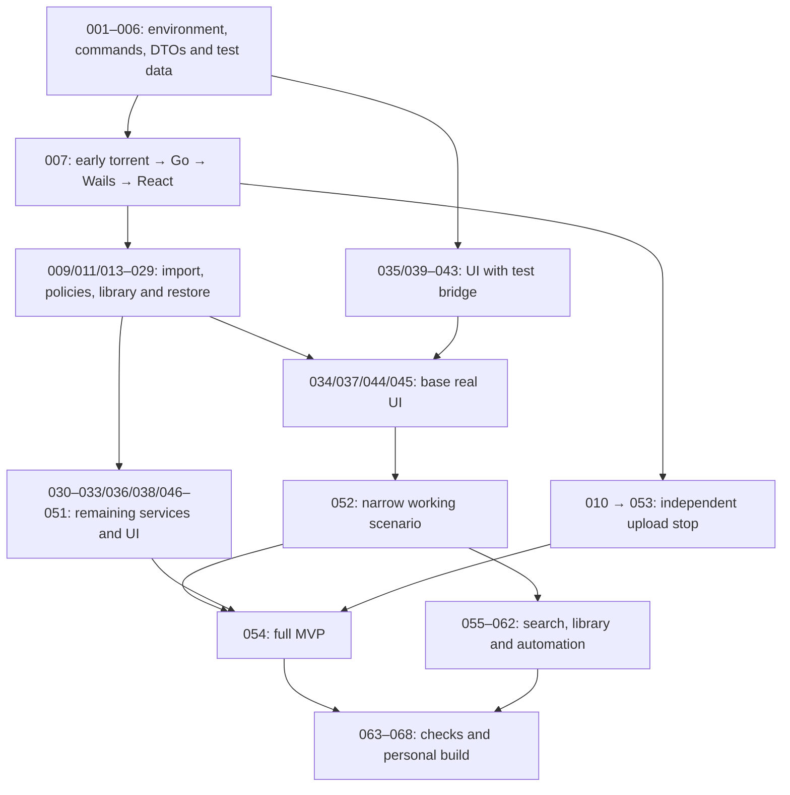

# OctopusTorrent — detailed development plan

**Date:** 14 October 2026. **Plan revision:** 3 — TDD, 100% coverage and architectural discipline. **Current state:** the status of every task is in the [navigation table](#navigation-of-all-tasks).

The plan covers **8 phases, 68 execution tasks, all 80 requirement IDs and 19 end-to-end scenarios**. The numbers are stable, and the start order is defined by the mandatory dependencies. Task 052 can be done before 030–033 and part of the UI tasks; numeric order is not an instruction to finish all lower numbers first. First we prove the risky contracts of the engine, persistence and macOS. Then we assemble a working main scenario, the full MVP, the agreed library and automation. We finish with a verified personal build and context handoff. A feature's checks are done together with it; the final phases investigate interactions and residual risks.

## Stack, scope and source of truth

| Part | Decision |
|---|---|
| Interface | React + TypeScript strict, Vite |
| Desktop / Go–TS link | Wails v2, native macOS WebView |
| Logic and file operations | Go |
| BitTorrent | anacrolix/torrent |
| Local library | SQLite via repository |

The goal is a personal local application on the owner's own Apple Silicon Mac. The network is needed for BitTorrent; the library and settings are local. Accounts, subscriptions, payments, a license server, cloud sync, analytics, TV streaming, a content catalog, cloud CI and releases for other platforms are out of scope. **AI-first means readable code and reproducible context in the repository; no AI model inside the application is needed.**

Document authority:

1. [PROJECT_REQUIREMENTS.md](../PROJECT_REQUIREMENTS.md) — behavior, criteria, 80 IDs and 19 scenarios.
2. [PRODUCT_CONCEPT.md](../PRODUCT_CONCEPT.md) — the idea, personal limits and agreed next capabilities.
3. [APPLICATION_ARCHITECTURE.md](../APPLICATION_ARCHITECTURE.md) — components, DTOs, lifecycles and data safety.
4. [ANACROLIX_TORRENT_TECHNICAL_RESEARCH.md](../ANACROLIX_TORRENT_TECHNICAL_RESEARCH.md) — API documentation and assumptions not yet confirmed by a prototype.
5. [HTML mockup](../MOCKUP.html) — reference for styling and interactions. Demo toggles are not carried over into the product.
6. The [mandatory engineering policy](../../docs/engineering/TDD_AND_QUALITY.md), [AGENTS.md](../../AGENTS.md) and the [feature documentation](../../docs/README.md) apply to every session.
7. This README and the numbered tasks are the way of execution, not a silent change of requirements. The old libtorrent in `product/archive/` is a historical reference, not the current engine.

The paths `internal/`, `frontend/`, `docs/`, `scripts/` are **proposed locations of future code**. [001](001-scope-and-decision-register.md) checks and defines the actual directory; [002](002-repository-and-agent-entrypoint.md) creates the entry point. The synced ChatGPT `sources/` remain read-only.

## Mandatory rules for every session and change

**TDD → 100% coverage → refactoring → up-to-date documentation → no debt** are conditions of every task, including early prototypes. At the start of every session the agent reads the architecture and the actual code, plans the impact and reuse, and writes the plan down before editing. Detailed metrics and measurement boundaries are in the [policy](../../docs/engineering/TDD_AND_QUALITY.md); entry rules are in [AGENTS.md](../../AGENTS.md).

RED records the required failing check before implementation; GREEN restores the correct behavior and 100%; REFACTOR removes duplication and wrong boundaries on green tests. A deferred test, a threshold workaround, an outdated feature document or leftover required temporary code forbid `done`. Until executable code exists, coverage is `not_applicable`, not an invented 100%.

## How to execute one task

1. Read the README, AGENTS.md, the engineering policy, the requirements and the architecture; in every session analyze the actual code, reuse and required refactoring, and write the plan down before making changes.
2. Pick a `planned` task whose mandatory dependencies are all `done` with the required evidence. Independent UI can be prepared via the test bridge after the contracts exist.
3. Go through the start conditions below. Change the status to `in_progress` in the file and in the navigation at the same time.
4. Carry out the substantive steps through RED → GREEN → REFACTOR. First a test of the required behavior, then the minimal implementation and 100% coverage, then refactoring and a repeated green run. The feature document is updated at the same time.
5. Run the actual commands from the root README/[004](004-reproducible-check-commands.md); record the code/build version, test data and result. The initial manual tasks do not need the future check runner.
6. Go through the acceptance criteria and completion conditions. Update decisions, contracts and commands, and write the context handoff.
7. Mark `done` only with evidence; a failed dependent check or a missing decision gives `blocked` with a reason. Partial readiness does not mean the whole requirement is complete.

### Tracking without duplication

Each task file is the source of its title, status, phase and mandatory dependencies. The navigation table below reproduces these fields and is never edited by hand: after changing a task file, `go tool devtool plan-nav` regenerates only the marked block, and `go tool devtool check-plan` verifies the whole plan (task files, links, an acyclic dependency graph, statuses, requirement and scenario coverage, the navigation block). The matrices of primary responsible tasks and acceptance scenarios are maintained separately by content.

Completing a task does not automatically complete all of its requirement IDs. Accepting a requirement needs all the relevant service, UI and integration evidence. For example, 005 describes the contract, 035 checks it in React, and 034/052 prove the real connection.

### Statuses and context handoff

| Status | Meaning |
|---|---|
| `planned` | Implementation has not started; the steps and tests are a plan. |
| `in_progress` | The task is being executed; not all criteria have passed yet. |
| `blocked` | There is a specific obstacle: a dependency, a failed check or an unresolved contract; record how to unblock it. |
| `done` | Criteria and checks are met, evidence is saved, documents and statuses are consistent. |

For checks, `pass`, `fail`, `not_run` are recorded separately; these are not task statuses. For a negative prototype, separately record the spike result and the state of the product control check: `pass`, `fail` or `unresolved`. If a task criterion requires working behavior, its status stays `blocked` until there is a verified solution. A completed report does not by itself unblock the dependent function. The report names the specific independent tasks that can continue. A TODO has a reason and a closing criterion. The context handoff contains the goal and changes, the actual modules, commands/results, ADRs, limitations and the next ready tasks. Required explanations do not stay only in the chat.

### Task start conditions

- The scope, requirement IDs and one verifiable outcome are clear.
- Dependencies are complete at the required boundary: reading an API does not substitute for experimental evidence.
- Modules, contracts and test data are found; tools/commands are known or this very task creates them.
- The open decision belongs to this task or to a specific preceding task. A dangerous spike uses only our own artificial files.
- Validation, cancellation, the error state and the observable result are thought through before code.

### Task completion conditions

- The criteria are proven through TDD, the required regression is green, and own executable code has exactly 100% of the defined metrics with a complete source inventory.
- The session's architectural plan and the actual impact are reconciled; refactoring of the affected scenario is complete, and new or affected required debt is not deferred.
- docs/<domain>/<feature>.md and the index are up to date; unrun tests, documentation and temporary workarounds block completion.
- The report contains the date, the change version and the checks performed. For network, file and system spikes, add versions, Mac/configuration, test data, exact commands and observations. For a document change, first check the required new state, then change it and re-check the structure/links. A network test unrelated to the change is not required; the evidence is its verifiable result.
- Go tests prove invariants, the real engine — bytes/traffic, the repository — SQLite, the test bridge — UI, the built .app — macOS integration.
- Resources are released, data is protected, and AppError does not hide an error as success.
- Exactly the affected README/AGENTS/ADR/API are updated; a new ADR is needed for a decision, not for every color change. Bindings are regenerated if the contract changed.
- For a new UI function, its texts in six languages, a clear error and a keyboard action are added. The base 041 does not substitute for the future localization of all screens.
- Task/README statuses are in sync; the repository is enough for the next agent.

Every change goes through TDD and the defined 100% coverage. Visual checks complement behavior tests and do not cancel the threshold; tests must check the result, not a copy of the implementation. The size estimate is qualitative, without invented hours: an independently verifiable part can be split off into a new numbered task, updating the dependencies and matrices.

## Phases and transition criteria

| Phase | Tasks | Transition result |
|---|---|---|
| P0 — Context and repository start | 001–002 | Scope, code directory, README/AGENTS and the decision register are defined. |
| P1 — Prototypes of risky contracts | 003–012 | 007 proves the real path torrent → Go → Wails → React early; the other spikes separately check persistence, magnet, upload and the Trash. A Trash failure does not block normal import. |
| P2 — Types, data and service boundaries | 013–018 | Policy, schema, repository, diagnostics and the adapter are verified; UI, SQL and the engine are not mixed. |
| P3 — Import, transfer and data safety | 019–033 | The service scenario of import, transfer, restart and deletion works on a controlled engine. |
| P4 — React UI and macOS integration | 034–051 | Base bindings and UI allow moving on to 052 without waiting for all additional commands. The rest of the UI is added gradually and is mandatory for 054. |
| P5 — Main scenario and full MVP | 052–054 | 052 checks a narrow persisted scenario without bulk deletion/Finder/Trash. 054 additionally accepts all these capabilities and independent upload disabling. |
| P6 — Library and local automation | 055–062 | Search, filters, collections, rules and watching work; automatic records are paused, sources are preserved. |
| P7 — Reliability, personal build and handoff | 063–068 | The 80 requirements and 19 scenarios have evidence; the .app is installed, the repository is usable by a new agent. |

Phases are a logical grouping, not barriers to independent work. For example, the React bridge/components can be prepared while Go storage/metadata are being investigated, if 005 is already done. **007 is an early temporary end-to-end prototype; 052 is a working scenario with persistence and restore; 054 is the whole agreed MVP; 068 is the full scope, including NEXT/COL/AUTO.**

## Main flow graph

This is an overview of capabilities, not an exact graph of every number. The mandatory dependencies are given in the table. Task durations have not been measured yet, so this is not a schedule estimate and not a time-calculated critical path.

### Recommended route to the first result

1. **Setup:** 001 → 002 → 003; then 004 and 005 independently.
2. **First real integration:** 006 → 007. The owner already sees real progress in the Wails window; the result is experimental, with no promise of a finished library.
3. **Reliable core:** complete the prerequisites 009/011/013–029. At the same time, 035/039–043 can be prepared with the test bridge.
4. **Early working route:** 034/037/040/044/045 and 029 → 052. Do not wait for 030–033, Finder, drag and drop or the whole settings panel.
5. **Full MVP:** the remaining services/UI and proven 010/053 → 054. A block on independent upload does not hide the readiness of 052, but does not allow calling the whole MVP complete.
6. **Agreed extension and completion:** 055–062, the independent checks 063/064/065, then 066–068. Collections are not a technical prerequisite for editing rules, and the VoiceOver check should not wait for long profiling.

### Parallel work without conflicts

| Stream | Can start | Owned files | Integration |
|---|---|---|---|
| Go engine/files | After 005/006/007 per dependencies | `internal/torrentengine`, `internal/files`, test data | Agreed DTOs before 034 |
| Go repository/services | After 008/013 | `internal/library`, migrations, `internal/app` | Contract 005, adapter 018, import 023 |
| React preparation | After 005 with the test bridge | `frontend/src/bridge/state/styles/features` | Real facade 034 and function dependencies |
| System shell | After 003 and the required service contracts | `internal/platform`, bundle metadata | Real .app, not only the browser |

This is a way of organizing work, not a requirement to run additional agents. Concurrent executors agree on file ownership. `go.mod`, schema/migrations, DTOs, `wails.json` and generated bindings are changed by one responsible party in a given piece of work; others propose the exact contract change. A shared workspace does not create private copies of files.

## Navigation of all tasks

<!-- TASKS-NAV:BEGIN -->
| ID / file | Task | Phase | Mandatory dependencies | Requirements | Status |
|---|---|---|---|---|---|
| [001](001-scope-and-decision-register.md) | Record the initial scope and open decisions | P0 | — | AI-06, DATA-01, QA-07 | `done` |
| [002](002-repository-and-agent-entrypoint.md) | Prepare the Git repository and the AI entry point | P0 | [001](001-scope-and-decision-register.md) | AI-01, AI-02, AI-03, AI-04, AI-09, QA-01, QA-03, QA-04, QA-07, QA-08 | `done` |
| [003](003-wails-macos-build-spike.md) | Build the first Wails .app on the owner's Mac | P1 | [002](002-repository-and-agent-entrypoint.md) | REL-01, REL-02, STACK-05, UI-04, AI-07, QA-01, QA-02, QA-05 | `done` |
| [004](004-reproducible-check-commands.md) | Record the build and local check commands | P1 | [003](003-wails-macos-build-spike.md) | AI-07, AI-08, QA-01, QA-02, QA-05 | `done` |
| [005](005-domain-dto-and-bridge-contract.md) | Describe our own Go–TS contracts and errors | P1 | [003](003-wails-macos-build-spike.md) | AI-05, AI-02, STACK-01, STACK-02, STACK-03 | `done` |
| [006](006-controlled-torrent-fixtures.md) | Create controlled torrents and a local swarm | P1 | [004](004-reproducible-check-commands.md) | AI-08, TR-02 | `done` |
| [007](007-engine-api-lifecycle-spike.md) | Check the anacrolix API and lifecycle on a single version | P1 | [006](006-controlled-torrent-fixtures.md), [005](005-domain-dto-and-bridge-contract.md) | AI-05, AI-07, STACK-03 | `done` |
| [008](008-sqlite-driver-durability-spike.md) | Choose the SQLite driver and data durability mode | P1 | [004](004-reproducible-check-commands.md) | STACK-04, SET-02, AI-07 | `done` |
| [009](009-storage-and-completion-spike.md) | Check file placement and persistence of verified-piece state | P1 | [007](007-engine-api-lifecycle-spike.md), [008](008-sqlite-driver-durability-spike.md) | SET-02, TR-05, ADD-04 | `done` |
| [010](010-upload-stop-and-pause-spike.md) | Measure stopping upload without stopping download | P1 | [007](007-engine-api-lifecycle-spike.md) | TR-01, TR-08, SET-08 | `done` |
| [011](011-magnet-metadata-storage-spike.md) | Check magnet metadata retrieval and the final file folder | P1 | [009](009-storage-and-completion-spike.md) | ADD-02, ADD-04, ADD-07 | `done` |
| [012](012-macos-trash-and-path-spike.md) | Check the macOS Trash and file path protection | P1 | [003](003-wails-macos-build-spike.md), [007](007-engine-api-lifecycle-spike.md) | DEL-02, DEL-04, STACK-01 | `planned` |
| [013](013-transfer-policy-state-machine.md) | Describe torrent transfer states and policy | P2 | [005](005-domain-dto-and-bridge-contract.md), [007](007-engine-api-lifecycle-spike.md) | TR-01, TR-03, STACK-03, AI-04 | `planned` |
| [014](014-sqlite-schema-migrations.md) | Create the SQLite schema and safe migrations | P2 | [005](005-domain-dto-and-bridge-contract.md), [008](008-sqlite-driver-durability-spike.md) | STACK-04, SET-02 | `planned` |
| [015](015-transactional-repositories.md) | Isolate SQL and ensure transactional writes | P2 | [014](014-sqlite-schema-migrations.md), [013](013-transfer-policy-state-machine.md) | STACK-04, SET-02, DATA-01 | `planned` |
| [016](016-migration-backup-corruption-recovery.md) | Protect the library from migration errors and DB corruption | P2 | [015](015-transactional-repositories.md) | SET-02, DATA-01, STACK-04 | `planned` |
| [017](017-local-diagnostics-privacy.md) | Create local diagnostics with private data protection | P2 | [005](005-domain-dto-and-bridge-contract.md), [004](004-reproducible-check-commands.md) | DATA-02, DATA-03 | `planned` |
| [018](018-torrent-engine-adapter.md) | Create a torrent engine adapter with explicit resource management | P2 | [007](007-engine-api-lifecycle-spike.md), [005](005-domain-dto-and-bridge-contract.md), [013](013-transfer-policy-state-machine.md) | AI-03, AI-04, AI-05, STACK-01, QA-03, QA-08 | `planned` |
| [019](019-metainfo-parser-file-tree.md) | Parse metadata and build a consistent file tree | P3 | [018](018-torrent-engine-adapter.md), [006](006-controlled-torrent-fixtures.md) | ADD-01, ADD-04, ADD-09, UI-18, STACK-01 | `planned` |
| [020](020-destination-filesystem-service.md) | Implement folder selection and a verified file path plan | P3 | [009](009-storage-and-completion-spike.md), [019](019-metainfo-parser-file-tree.md), [015](015-transactional-repositories.md) | ADD-04, ADD-08, SET-01, SET-05, STACK-01 | `planned` |
| [021](021-full-hash-deduplication.md) | Avoid duplicates by full torrent hashes | P3 | [019](019-metainfo-parser-file-tree.md), [015](015-transactional-repositories.md) | ADD-03, STACK-03, SET-02 | `planned` |
| [022](022-pending-import-coordinator.md) | Create a single coordinator for pending imports | P3 | [011](011-magnet-metadata-storage-spike.md), [019](019-metainfo-parser-file-tree.md), [020](020-destination-filesystem-service.md), [021](021-full-hash-deduplication.md) | ADD-01, ADD-02, ADD-06, ADD-07, STACK-03 | `planned` |
| [023](023-durable-import-commit.md) | Persist the import and policies before file transfer starts | P3 | [022](022-pending-import-coordinator.md), [015](015-transactional-repositories.md), [013](013-transfer-policy-state-machine.md), [009](009-storage-and-completion-spike.md) | ADD-04, ADD-07, SET-02, STACK-04 | `planned` |
| [024](024-file-folder-wanted-commands.md) | Manage selection of files and all descendants of a folder | P3 | [023](023-durable-import-commit.md), [013](013-transfer-policy-state-machine.md) | TR-06, TR-07, UI-09, UI-18 | `planned` |
| [025](025-pause-resume-application.md) | Implement torrent start and manual pause | P3 | [023](023-durable-import-commit.md), [013](013-transfer-policy-state-machine.md), [018](018-torrent-engine-adapter.md) | TR-01, STACK-03 | `planned` |
| [026](026-rate-limits-seed-network.md) | Implement global limits, seeding and network recovery | P3 | [025](025-pause-resume-application.md), [015](015-transactional-repositories.md) | TR-03, TR-04, TR-05 | `planned` |
| [027](027-metrics-status-snapshots.md) | Publish accurate progress and state snapshots | P3 | [024](024-file-folder-wanted-commands.md), [025](025-pause-resume-application.md), [026](026-rate-limits-seed-network.md), [005](005-domain-dto-and-bridge-contract.md) | TR-02, UI-01, UI-02, UI-08, UI-12, UI-19, STACK-02 | `planned` |
| [028](028-application-startup-quit.md) | Implement startup, single instance and quit of the .app | P3 | [018](018-torrent-engine-adapter.md), [015](015-transactional-repositories.md), [017](017-local-diagnostics-privacy.md), [003](003-wails-macos-build-spike.md) | SET-02, STACK-05, DATA-01 | `planned` |
| [029](029-restore-recheck-reconciliation.md) | Restore the library after restart and crash | P3 | [028](028-application-startup-quit.md), [023](023-durable-import-commit.md), [024](024-file-folder-wanted-commands.md), [027](027-metrics-status-snapshots.md), [016](016-migration-backup-corruption-recovery.md), [009](009-storage-and-completion-spike.md) | SET-02, TR-05, DATA-01 | `planned` |
| [030](030-relink-missing-payload.md) | Re-select the location of missing data | P3 | [029](029-restore-recheck-reconciliation.md), [020](020-destination-filesystem-service.md) | SET-03, TR-05 | `planned` |
| [031](031-delete-record-lifecycle.md) | Remove a record while keeping files | P3 | [029](029-restore-recheck-reconciliation.md), [025](025-pause-resume-application.md) | DEL-01, DEL-03, STACK-03 | `planned` |
| [032](032-safe-payload-trash-journal.md) | Safely move confirmed files to the Trash | P3 | [031](031-delete-record-lifecycle.md), [020](020-destination-filesystem-service.md), [012](012-macos-trash-and-path-spike.md) | DEL-02, DEL-04, DEL-05, STACK-01 | `planned` |
| [033](033-bulk-command-service.md) | Execute bulk commands with partial results | P3 | [025](025-pause-resume-application.md), [031](031-delete-record-lifecycle.md), [032](032-safe-payload-trash-journal.md) | UI-07, DEL-05, STACK-03 | `planned` |
| [034](034-wails-facade-real-bindings.md) | Connect Go services to real Wails bindings | P4 | [027](027-metrics-status-snapshots.md), [028](028-application-startup-quit.md) | STACK-01, AI-05 | `planned` |
| [035](035-react-bridge-state-resync.md) | Implement the React bridge and snapshot resync | P4 | [005](005-domain-dto-and-bridge-contract.md), [004](004-reproducible-check-commands.md) | STACK-02, AI-04, AI-08 | `planned` |
| [036](036-finder-magnet-open-queue.md) | Support Finder and system opening of magnet links | P4 | [034](034-wails-facade-real-bindings.md), [022](022-pending-import-coordinator.md) | ADD-01, ADD-02, SET-07, STACK-05 | `planned` |
| [037](037-native-dialogs-clipboard.md) | Implement native dialogs and full path copying | P4 | [034](034-wails-facade-real-bindings.md), [020](020-destination-filesystem-service.md) | ADD-01, ADD-04, ADD-08, SET-01, SET-03, SET-05, UI-12 | `planned` |
| [038](038-native-drop-menus-shortcuts.md) | Add native drag and drop, menus and keyboard | P4 | [034](034-wails-facade-real-bindings.md), [036](036-finder-magnet-open-queue.md), [037](037-native-dialogs-clipboard.md) | ADD-06, UI-04, UI-17 | `planned` |
| [039](039-visual-primitives-tokens.md) | Port design tokens and base components | P4 | [003](003-wails-macos-build-spike.md), [005](005-domain-dto-and-bridge-contract.md) | UI-06, UI-04, UI-15, AI-03, QA-01, QA-02, QA-03 | `planned` |
| [040](040-app-shell-fixed-geometry.md) | Build a stable window with independent scrolling | P4 | [035](035-react-bridge-state-resync.md), [039](039-visual-primitives-tokens.md) | UI-16, UI-17, UI-06 | `planned` |
| [041](041-six-languages-formatters.md) | Implement six languages and data formatting | P4 | [035](035-react-bridge-state-resync.md), [039](039-visual-primitives-tokens.md), [015](015-transactional-repositories.md) | SET-06, UI-12, REL-03 | `planned` |
| [042](042-appearance-theme-opaque.md) | Support themes and the opaque appearance | P4 | [040](040-app-shell-fixed-geometry.md), [015](015-transactional-repositories.md) | SET-04, UI-06, UI-04 | `planned` |
| [043](043-modal-focus-operations.md) | Implement modal dialogs, focus and cancellation | P4 | [035](035-react-bridge-state-resync.md), [039](039-visual-primitives-tokens.md), [041](041-six-languages-formatters.md) | UI-04, ADD-07, DEL-02 | `planned` |
| [044](044-import-preview-ui-tree.md) | Build the add preview with a tree | P4 | [043](043-modal-focus-operations.md), [037](037-native-dialogs-clipboard.md), [022](022-pending-import-coordinator.md), [023](023-durable-import-commit.md) | ADD-01, ADD-02, ADD-04, ADD-07, ADD-08, ADD-09 | `planned` |
| [045](045-torrent-cards-status-actions.md) | Build cards, statuses and main actions | P4 | [040](040-app-shell-fixed-geometry.md), [041](041-six-languages-formatters.md), [027](027-metrics-status-snapshots.md), [025](025-pause-resume-application.md) | UI-01, UI-08, UI-13, UI-19, UI-12, UI-15 | `planned` |
| [046](046-post-import-file-folder-tree.md) | Build the tree of file and folder buttons | P4 | [044](044-import-preview-ui-tree.md), [024](024-file-folder-wanted-commands.md), [045](045-torrent-cards-status-actions.md) | UI-09, UI-11, UI-18, TR-06, TR-07 | `planned` |
| [047](047-inspector-full-path-recovery.md) | Build details, full path and missing-data search | P4 | [046](046-post-import-file-folder-tree.md), [037](037-native-dialogs-clipboard.md), [030](030-relink-missing-payload.md) | UI-02, UI-11, UI-12, UI-15, SET-03 | `planned` |
| [048](048-persistent-bulk-selection-ui.md) | Implement persistent bulk selection | P4 | [045](045-torrent-cards-status-actions.md), [033](033-bulk-command-service.md), [043](043-modal-focus-operations.md) | UI-07, DEL-05 | `planned` |
| [049](049-delete-confirmation-result-ui.md) | Confirm deletion and show partial results | P4 | [048](048-persistent-bulk-selection-ui.md), [047](047-inspector-full-path-recovery.md), [032](032-safe-payload-trash-journal.md) | DEL-01, DEL-02, DEL-04, DEL-05, UI-13 | `planned` |
| [050](050-settings-ui-save-feedback.md) | Build settings with a truthful save result | P4 | [037](037-native-dialogs-clipboard.md), [041](041-six-languages-formatters.md), [042](042-appearance-theme-opaque.md), [026](026-rate-limits-seed-network.md), [015](015-transactional-repositories.md) | SET-01, SET-04, SET-05, SET-06, SET-07, TR-04 | `planned` |
| [051](051-offline-errors-notifications.md) | Show errors, lack of network and operation retry | P4 | [045](045-torrent-cards-status-actions.md), [047](047-inspector-full-path-recovery.md), [017](017-local-diagnostics-privacy.md), [029](029-restore-recheck-reconciliation.md), [041](041-six-languages-formatters.md) | UI-03, UI-10, DATA-01, DATA-03, TR-05 | `planned` |
| [052](052-first-working-core-gate.md) | Accept the first working end-to-end scenario | P5 | [034](034-wails-facade-real-bindings.md), [035](035-react-bridge-state-resync.md), [040](040-app-shell-fixed-geometry.md), [044](044-import-preview-ui-tree.md), [045](045-torrent-cards-status-actions.md), [029](029-restore-recheck-reconciliation.md) | AI-08, STACK-05, TR-02 | `planned` |
| [053](053-global-upload-policy-production.md) | Implement independent global upload disabling | P5 | [010](010-upload-stop-and-pause-spike.md), [025](025-pause-resume-application.md), [026](026-rate-limits-seed-network.md), [029](029-restore-recheck-reconciliation.md), [015](015-transactional-repositories.md) | TR-08, SET-08 | `planned` |
| [054](054-global-upload-ui-mvp-gate.md) | Finish the upload settings and accept the full MVP | P5 | [053](053-global-upload-policy-production.md), [052](052-first-working-core-gate.md), [036](036-finder-magnet-open-queue.md), [038](038-native-drop-menus-shortcuts.md), [046](046-post-import-file-folder-tree.md), [047](047-inspector-full-path-recovery.md), [048](048-persistent-bulk-selection-ui.md), [049](049-delete-confirmation-result-ui.md), [050](050-settings-ui-save-feedback.md), [051](051-offline-errors-notifications.md) | SET-08, TR-08, AI-08 | `planned` |
| [055](055-search-status-filters.md) | Add search and status filters | P6 | [040](040-app-shell-fixed-geometry.md), [048](048-persistent-bulk-selection-ui.md), [027](027-metrics-status-snapshots.md) | NEXT-01, NEXT-02, UI-07, UI-16 | `planned` |
| [056](056-local-tags-crud.md) | Implement local tags | P6 | [052](052-first-working-core-gate.md), [015](015-transactional-repositories.md), [034](034-wails-facade-real-bindings.md), [041](041-six-languages-formatters.md) | COL-01 | `planned` |
| [057](057-smart-collections.md) | Implement smart collections | P6 | [056](056-local-tags-crud.md), [055](055-search-status-filters.md) | COL-01 | `planned` |
| [058](058-rules-semantics-preview-evaluator.md) | Agree on the rules and compute their preview result | P6 | [056](056-local-tags-crud.md), [022](022-pending-import-coordinator.md), [020](020-destination-filesystem-service.md) | AUTO-02 | `planned` |
| [059](059-rules-crud-import-application.md) | Persist rules and apply them on import | P6 | [058](058-rules-semantics-preview-evaluator.md), [023](023-durable-import-commit.md), [050](050-settings-ui-save-feedback.md) | AUTO-02 | `planned` |
| [060](060-watch-folder-stable-detection.md) | Reliably watch for new .torrent files | P6 | [028](028-application-startup-quit.md), [019](019-metainfo-parser-file-tree.md), [021](021-full-hash-deduplication.md), [020](020-destination-filesystem-service.md) | AUTO-01 | `planned` |
| [061](061-watch-folder-settings-queue-ui.md) | Configure preview and paused automatic adding | P6 | [060](060-watch-folder-stable-detection.md), [059](059-rules-crud-import-application.md), [044](044-import-preview-ui-tree.md), [050](050-settings-ui-save-feedback.md) | AUTO-01, AUTO-02 | `planned` |
| [062](062-automation-end-to-end-gate.md) | Accept collections, rules and the watch folder | P6 | [057](057-smart-collections.md), [061](061-watch-folder-settings-queue-ui.md), [055](055-search-status-filters.md) | COL-01, AUTO-01, AUTO-02, AI-08 | `planned` |
| [063](063-failure-race-fuzz-regression.md) | Check failures, races and crash recovery | P7 | [054](054-global-upload-ui-mvp-gate.md), [062](062-automation-end-to-end-gate.md), [032](032-safe-payload-trash-journal.md), [029](029-restore-recheck-reconciliation.md) | AI-08, STACK-03, STACK-04, TR-05, DEL-04, QA-02, QA-05, QA-06, QA-08 | `planned` |
| [064](064-scale-profiling-lifecycle-soak.md) | Measure large libraries and long-running operation | P7 | [062](062-automation-end-to-end-gate.md), [054](054-global-upload-ui-mvp-gate.md), [040](040-app-shell-fixed-geometry.md), [046](046-post-import-file-folder-tree.md), [027](027-metrics-status-snapshots.md) | UI-16, UI-15, STACK-02, AI-08 | `planned` |
| [065](065-native-accessibility-language-gate.md) | Check keyboard, VoiceOver and macOS WebView | P7 | [054](054-global-upload-ui-mvp-gate.md), [062](062-automation-end-to-end-gate.md), [041](041-six-languages-formatters.md), [042](042-appearance-theme-opaque.md) | UI-04, UI-06, SET-06, SET-04, STACK-05 | `planned` |
| [066](066-personal-build-install-license-audit.md) | Build and install the personal release | P7 | [063](063-failure-race-fuzz-regression.md), [064](064-scale-profiling-lifecycle-soak.md), [065](065-native-accessibility-language-gate.md) | REL-01, REL-02, STACK-05, DATA-02 | `planned` |
| [067](067-owner-help-upgrade-recovery-runbook.md) | Write local help and the recovery procedure | P7 | [066](066-personal-build-install-license-audit.md), [062](062-automation-end-to-end-gate.md), [029](029-restore-recheck-reconciliation.md) | REL-03, AI-06, AI-09, QA-04 | `planned` |
| [068](068-full-acceptance-clean-context-handoff.md) | Close all requirements and hand off the project without chat | P7 | [067](067-owner-help-upgrade-recovery-runbook.md), [063](063-failure-race-fuzz-regression.md), [064](064-scale-profiling-lifecycle-soak.md), [065](065-native-accessibility-language-gate.md), [066](066-personal-build-install-license-audit.md) | AI-10, AI-01, AI-09, AI-08, QA-01, QA-02, QA-03, QA-04, QA-05, QA-06, QA-07, QA-08 | `planned` |
<!-- TASKS-NAV:END -->

## Full coverage of the 80 requirements

The primary task is responsible for closing the whole criterion and collects the evidence of adjacent parts: UI, engine, DB and macOS. It does not necessarily implement all modules itself. The check column shows repeated acceptance. All criteria are still **planned**; a mention of an ID does not mean implementation.

| ID | Requirement | Primary task | Check |
|---|---|---|---|
| ADD-01 | Add a local `.torrent` file via a button in the application, the "Open With" command and a double-click in Finder, if the user has set OctopusTorrent as the default application. | [022](022-pending-import-coordinator.md) | [036](036-finder-magnet-open-queue.md), [038](038-native-drop-menus-shortcuts.md), [066](066-personal-build-install-license-audit.md), [068](068-full-acceptance-clean-context-handoff.md) |
| ADD-02 | Add magnet links by pasting in the application and by opening the link through the system. | [022](022-pending-import-coordinator.md) | [036](036-finder-magnet-open-queue.md), [038](038-native-drop-menus-shortcuts.md), [066](066-personal-build-install-license-audit.md), [068](068-full-acceptance-clean-context-handoff.md) |
| ADD-03 | Do not create a duplicate of an already added torrent. | [021](021-full-hash-deduplication.md) | [052 — partially](052-first-working-core-gate.md), [054](054-global-upload-ui-mvp-gate.md), [063](063-failure-race-fuzz-regression.md), [068](068-full-acceptance-clean-context-handoff.md) |
| ADD-04 | Before starting, allow choosing the destination folder and the files to download. | [023](023-durable-import-commit.md) | [052 — partially](052-first-working-core-gate.md), [054](054-global-upload-ui-mvp-gate.md), [063](063-failure-race-fuzz-regression.md), [068](068-full-acceptance-clean-context-handoff.md) |
| ADD-06 | Accept a single `.torrent` dragged into the zone at the bottom of the sidebar. | [038](038-native-drop-menus-shortcuts.md) | [036](036-finder-magnet-open-queue.md), [038](038-native-drop-menus-shortcuts.md), [066](066-personal-build-install-license-audit.md), [068](068-full-acceptance-clean-context-handoff.md) |
| ADD-07 | Show the torrent setup dialog before adding. | [044](044-import-preview-ui-tree.md) | [052 — partially](052-first-working-core-gate.md), [054](054-global-upload-ui-mvp-gate.md), [063](063-failure-race-fuzz-regression.md), [068](068-full-acceptance-clean-context-handoff.md) |
| ADD-08 | In the add dialog, allow choosing an existing folder or creating a new one by specifying its name and parent folder. | [020](020-destination-filesystem-service.md) | [052 — partially](052-first-working-core-gate.md), [054](054-global-upload-ui-mvp-gate.md), [063](063-failure-race-fuzz-regression.md), [068](068-full-acceptance-clean-context-handoff.md) |
| ADD-09 | Show nested folders in the file preview. | [044](044-import-preview-ui-tree.md) | [052 — partially](052-first-working-core-gate.md), [054](054-global-upload-ui-mvp-gate.md), [063](063-failure-race-fuzz-regression.md), [068](068-full-acceptance-clean-context-handoff.md) |
| TR-01 | Start, pause and resume a torrent. | [025](025-pause-resume-application.md) | [052 — partially](052-first-working-core-gate.md), [054](054-global-upload-ui-mvp-gate.md), [063](063-failure-race-fuzz-regression.md), [068](068-full-acceptance-clean-context-handoff.md) |
| TR-02 | Download the selected files and show progress in real time. | [027](027-metrics-status-snapshots.md) | [052 — partially](052-first-working-core-gate.md), [054](054-global-upload-ui-mvp-gate.md), [063](063-failure-race-fuzz-regression.md), [068](068-full-acceptance-clean-context-handoff.md) |
| TR-03 | Keep seeding after completion. | [026](026-rate-limits-seed-network.md) | [052 — partially](052-first-working-core-gate.md), [054](054-global-upload-ui-mvp-gate.md), [063](063-failure-race-fuzz-regression.md), [068](068-full-acceptance-clean-context-handoff.md) |
| TR-04 | Provide global settings for maximum download and upload speed. | [026](026-rate-limits-seed-network.md) | [052 — partially](052-first-working-core-gate.md), [054](054-global-upload-ui-mvp-gate.md), [063](063-failure-race-fuzz-regression.md), [068](068-full-acceptance-clean-context-handoff.md) |
| TR-05 | Resume work after network loss or an application restart. | [029](029-restore-recheck-reconciliation.md) | [052 — partially](052-first-working-core-gate.md), [054](054-global-upload-ui-mvp-gate.md), [063](063-failure-race-fuzz-regression.md), [068](068-full-acceptance-clean-context-handoff.md) |
| TR-06 | Allow stopping further targeted download of an individual file and selecting it again. | [024](024-file-folder-wanted-commands.md) | [052 — partially](052-first-working-core-gate.md), [054](054-global-upload-ui-mvp-gate.md), [063](063-failure-race-fuzz-regression.md), [068](068-full-acceptance-clean-context-handoff.md) |
| TR-07 | Allow download control for a whole folder. | [024](024-file-folder-wanted-commands.md) | [052 — partially](052-first-working-core-gate.md), [054](054-global-upload-ui-mvp-gate.md), [063](063-failure-race-fuzz-regression.md), [068](068-full-acceptance-clean-context-handoff.md) |
| TR-08 | Control upload globally, independently of download. | [053](053-global-upload-policy-production.md) | [010](010-upload-stop-and-pause-spike.md), [054](054-global-upload-ui-mvp-gate.md), [063](063-failure-race-fuzz-regression.md), [068](068-full-acceptance-clean-context-handoff.md) |
| UI-01 | Show the torrent list with name, status, progress, size and speed. | [045](045-torrent-cards-status-actions.md) | [064](064-scale-profiling-lifecycle-soak.md), [065](065-native-accessibility-language-gate.md), [068](068-full-acceptance-clean-context-handoff.md) |
| UI-02 | Show details of the selected torrent. | [047](047-inspector-full-path-recovery.md) | [064](064-scale-profiling-lifecycle-soak.md), [065](065-native-accessibility-language-gate.md), [068](068-full-acceptance-clean-context-handoff.md) |
| UI-03 | Explain the empty state and errors in plain language. | [051](051-offline-errors-notifications.md) | [064](064-scale-profiling-lifecycle-soak.md), [065](065-native-accessibility-language-gate.md), [068](068-full-acceptance-clean-context-handoff.md) |
| UI-04 | Implement the interface in React + TypeScript in Wails. | [065](065-native-accessibility-language-gate.md) | [064](064-scale-profiling-lifecycle-soak.md), [065](065-native-accessibility-language-gate.md), [068](068-full-acceptance-clean-context-handoff.md) |
| UI-06 | Keep the glass styling of the sidebar and top bar from the mockup. | [042](042-appearance-theme-opaque.md) | [064](064-scale-profiling-lifecycle-soak.md), [065](065-native-accessibility-language-gate.md), [068](068-full-acceptance-clean-context-handoff.md) |
| UI-07 | Allow selecting several torrents in the "All torrents" section and performing a bulk action. | [048](048-persistent-bulk-selection-ui.md) | [064](064-scale-profiling-lifecycle-soak.md), [065](065-native-accessibility-language-gate.md), [068](068-full-acceptance-clean-context-handoff.md) |
| UI-08 | Show state and speed directly in the torrent card. | [045](045-torrent-cards-status-actions.md) | [064](064-scale-profiling-lifecycle-soak.md), [065](065-native-accessibility-language-gate.md), [068](068-full-acceptance-clean-context-handoff.md) |
| UI-09 | Show play/pause buttons next to each file in the card and in the details. | [046](046-post-import-file-folder-tree.md) | [064](064-scale-profiling-lifecycle-soak.md), [065](065-native-accessibility-language-gate.md), [068](068-full-acceptance-clean-context-handoff.md) |
| UI-10 | Show errors and lack of network in a separate area below the window's top bar. | [051](051-offline-errors-notifications.md) | [064](064-scale-profiling-lifecycle-soak.md), [065](065-native-accessibility-language-gate.md), [068](068-full-acceptance-clean-context-handoff.md) |
| UI-11 | Expand the torrent card and also show files in the details panel. | [046](046-post-import-file-folder-tree.md) | [064](064-scale-profiling-lifecycle-soak.md), [065](065-native-accessibility-language-gate.md), [068](068-full-acceptance-clean-context-handoff.md) |
| UI-12 | Show size and path so that the data can be read and used. | [047](047-inspector-full-path-recovery.md) | [064](064-scale-profiling-lifecycle-soak.md), [065](065-native-accessibility-language-gate.md), [068](068-full-acceptance-clean-context-handoff.md) |
| UI-13 | Provide the main actions right next to the torrent. | [045](045-torrent-cards-status-actions.md) | [064](064-scale-profiling-lifecycle-soak.md), [065](065-native-accessibility-language-gate.md), [068](068-full-acceptance-clean-context-handoff.md) |
| UI-15 | Constrain long values in narrow rows. | [045](045-torrent-cards-status-actions.md) | [064](064-scale-profiling-lifecycle-soak.md), [065](065-native-accessibility-language-gate.md), [068](068-full-acceptance-clean-context-handoff.md) |
| UI-16 | Scroll long lists inside the window. | [040](040-app-shell-fixed-geometry.md) | [064](064-scale-profiling-lifecycle-soak.md), [065](065-native-accessibility-language-gate.md), [068](068-full-acceptance-clean-context-handoff.md) |
| UI-17 | Place the main add action in the top bar. | [040](040-app-shell-fixed-geometry.md) | [064](064-scale-profiling-lifecycle-soak.md), [065](065-native-accessibility-language-gate.md), [068](068-full-acceptance-clean-context-handoff.md) |
| UI-18 | Show torrent files as a tree if there are folders. | [046](046-post-import-file-folder-tree.md) | [064](064-scale-profiling-lifecycle-soak.md), [065](065-native-accessibility-language-gate.md), [068](068-full-acceptance-clean-context-handoff.md) |
| UI-19 | Show the transfer direction or stop at the start of the torrent card. | [045](045-torrent-cards-status-actions.md) | [064](064-scale-profiling-lifecycle-soak.md), [065](065-native-accessibility-language-gate.md), [068](068-full-acceptance-clean-context-handoff.md) |
| DEL-01 | Offer "Remove torrent from list" and "Delete torrent and files" separately. | [031](031-delete-record-lifecycle.md) | [052 — partially](052-first-working-core-gate.md), [054](054-global-upload-ui-mvp-gate.md), [063](063-failure-race-fuzz-regression.md), [068](068-full-acceptance-clean-context-handoff.md) |
| DEL-02 | Before deleting files, show a confirmation listing the files and their location. | [032](032-safe-payload-trash-journal.md) | [052 — partially](052-first-working-core-gate.md), [054](054-global-upload-ui-mvp-gate.md), [063](063-failure-race-fuzz-regression.md), [068](068-full-acceptance-clean-context-handoff.md) |
| DEL-03 | Stop transfer when a record is removed. | [031](031-delete-record-lifecycle.md) | [052 — partially](052-first-working-core-gate.md), [054](054-global-upload-ui-mvp-gate.md), [063](063-failure-race-fuzz-regression.md), [068](068-full-acceptance-clean-context-handoff.md) |
| DEL-04 | Handle file access errors without a false success message. | [032](032-safe-payload-trash-journal.md) | [052 — partially](052-first-working-core-gate.md), [054](054-global-upload-ui-mvp-gate.md), [063](063-failure-race-fuzz-regression.md), [068](068-full-acceptance-clean-context-handoff.md) |
| DEL-05 | Confirm bulk deletion of selected torrents. | [049](049-delete-confirmation-result-ui.md) | [052 — partially](052-first-working-core-gate.md), [054](054-global-upload-ui-mvp-gate.md), [063](063-failure-race-fuzz-regression.md), [068](068-full-acceptance-clean-context-handoff.md) |
| SET-01 | In settings, choose the default download folder via the system folder picker. | [050](050-settings-ui-save-feedback.md) | [052 — partially](052-first-working-core-gate.md), [054](054-global-upload-ui-mvp-gate.md), [063](063-failure-race-fuzz-regression.md), [068](068-full-acceptance-clean-context-handoff.md) |
| SET-02 | Store the library and transfer policy locally. | [029](029-restore-recheck-reconciliation.md) | [052 — partially](052-first-working-core-gate.md), [054](054-global-upload-ui-mvp-gate.md), [063](063-failure-race-fuzz-regression.md), [068](068-full-acceptance-clean-context-handoff.md) |
| SET-03 | Do not turn a missing or unavailable folder into silent data loss. | [030](030-relink-missing-payload.md) | [052 — partially](052-first-working-core-gate.md), [054](054-global-upload-ui-mvp-gate.md), [063](063-failure-race-fuzz-regression.md), [068](068-full-acceptance-clean-context-handoff.md) |
| SET-04 | In settings, choose the appearance: "System", "Light" or "Dark". | [042](042-appearance-theme-opaque.md) | [065](065-native-accessibility-language-gate.md), [068](068-full-acceptance-clean-context-handoff.md) |
| SET-05 | For the default download folder, allow choosing an existing folder or creating a new one by name inside the chosen parent folder. | [050](050-settings-ui-save-feedback.md) | [052 — partially](052-first-working-core-gate.md), [054](054-global-upload-ui-mvp-gate.md), [063](063-failure-race-fuzz-regression.md), [068](068-full-acceptance-clean-context-handoff.md) |
| SET-06 | In settings, choose the interface language: English, Ukrainian, Spanish, German, French or Portuguese. | [041](041-six-languages-formatters.md) | [065](065-native-accessibility-language-gate.md), [068](068-full-acceptance-clean-context-handoff.md) |
| SET-07 | Let the user make OctopusTorrent the default application for `.torrent`. | [036](036-finder-magnet-open-queue.md) | [036](036-finder-magnet-open-queue.md), [038](038-native-drop-menus-shortcuts.md), [066](066-personal-build-install-license-audit.md), [068](068-full-acceptance-clean-context-handoff.md) |
| SET-08 | Provide a global upload toggle for all torrents. | [054](054-global-upload-ui-mvp-gate.md) | [010](010-upload-stop-and-pause-spike.md), [054](054-global-upload-ui-mvp-gate.md), [063](063-failure-race-fuzz-regression.md), [068](068-full-acceptance-clean-context-handoff.md) |
| REL-01 | Install the personal build locally. | [066](066-personal-build-install-license-audit.md) | [066](066-personal-build-install-license-audit.md), [068](068-full-acceptance-clean-context-handoff.md) |
| REL-02 | Check the signature and dependencies of the installed build. | [066](066-personal-build-install-license-audit.md) | [066](066-personal-build-install-license-audit.md), [068](068-full-acceptance-clean-context-handoff.md) |
| REL-03 | Keep brief local help. | [067](067-owner-help-upgrade-recovery-runbook.md) | [066](066-personal-build-install-license-audit.md), [068](068-full-acceptance-clean-context-handoff.md) |
| COL-01 | Tags and smart collections | [057](057-smart-collections.md) | [062](062-automation-end-to-end-gate.md), [064](064-scale-profiling-lifecycle-soak.md), [068](068-full-acceptance-clean-context-handoff.md) |
| AUTO-01 | Watch folder | [061](061-watch-folder-settings-queue-ui.md) | [062](062-automation-end-to-end-gate.md), [064](064-scale-profiling-lifecycle-soak.md), [068](068-full-acceptance-clean-context-handoff.md) |
| AUTO-02 | Rules for new torrents | [059](059-rules-crud-import-application.md) | [062](062-automation-end-to-end-gate.md), [064](064-scale-profiling-lifecycle-soak.md), [068](068-full-acceptance-clean-context-handoff.md) |
| DATA-01 | Store the library and settings locally. | [015](015-transactional-repositories.md) | [063](063-failure-race-fuzz-regression.md), [066](066-personal-build-install-license-audit.md), [068](068-full-acceptance-clean-context-handoff.md) |
| DATA-02 | Do not collect product analytics. | [017](017-local-diagnostics-privacy.md) | [063](063-failure-race-fuzz-regression.md), [066](066-personal-build-install-license-audit.md), [068](068-full-acceptance-clean-context-handoff.md) |
| DATA-03 | Have local diagnostics for development. | [017](017-local-diagnostics-privacy.md) | [063](063-failure-race-fuzz-regression.md), [066](066-personal-build-install-license-audit.md), [068](068-full-acceptance-clean-context-handoff.md) |
| NEXT-01 | Search in the torrent list | [055](055-search-status-filters.md) | [062](062-automation-end-to-end-gate.md), [064](064-scale-profiling-lifecycle-soak.md), [068](068-full-acceptance-clean-context-handoff.md) |
| NEXT-02 | List filters | [055](055-search-status-filters.md) | [062](062-automation-end-to-end-gate.md), [064](064-scale-profiling-lifecycle-soak.md), [068](068-full-acceptance-clean-context-handoff.md) |
| STACK-01 | Isolate access to native capabilities in Go. | [034](034-wails-facade-real-bindings.md) | [052 — partially](052-first-working-core-gate.md), [054](054-global-upload-ui-mvp-gate.md), [063](063-failure-race-fuzz-regression.md), [065](065-native-accessibility-language-gate.md), [068](068-full-acceptance-clean-context-handoff.md) |
| STACK-02 | Pass consistent Go–TS state snapshots. | [035](035-react-bridge-state-resync.md) | [052 — partially](052-first-working-core-gate.md), [054](054-global-upload-ui-mvp-gate.md), [063](063-failure-race-fuzz-regression.md), [065](065-native-accessibility-language-gate.md), [068](068-full-acceptance-clean-context-handoff.md) |
| STACK-03 | Serialize policy changes of each torrent. | [013](013-transfer-policy-state-machine.md) | [052 — partially](052-first-working-core-gate.md), [054](054-global-upload-ui-mvp-gate.md), [063](063-failure-race-fuzz-regression.md), [065](065-native-accessibility-language-gate.md), [068](068-full-acceptance-clean-context-handoff.md) |
| STACK-04 | Manage SQLite only through the repository. | [015](015-transactional-repositories.md) | [052 — partially](052-first-working-core-gate.md), [054](054-global-upload-ui-mvp-gate.md), [063](063-failure-race-fuzz-regression.md), [065](065-native-accessibility-language-gate.md), [068](068-full-acceptance-clean-context-handoff.md) |
| STACK-05 | Prove the build and native integration on the owner's Mac. | [066](066-personal-build-install-license-audit.md) | [052 — partially](052-first-working-core-gate.md), [054](054-global-upload-ui-mvp-gate.md), [063](063-failure-race-fuzz-regression.md), [065](065-native-accessibility-language-gate.md), [068](068-full-acceptance-clean-context-handoff.md) |
| AI-01 | Give the agent an entry point into the repository. | [002](002-repository-and-agent-entrypoint.md) | [063](063-failure-race-fuzz-regression.md), [068](068-full-acceptance-clean-context-handoff.md) |
| AI-02 | Use unambiguous names and explicit data types. | [005](005-domain-dto-and-bridge-contract.md) | [063](063-failure-race-fuzz-regression.md), [068](068-full-acceptance-clean-context-handoff.md) |
| AI-03 | Split code by responsibility. | [018](018-torrent-engine-adapter.md) | [063](063-failure-race-fuzz-regression.md), [068](068-full-acceptance-clean-context-handoff.md) |
| AI-04 | Make dependencies and side effects visible. | [013](013-transfer-policy-state-machine.md) | [063](063-failure-race-fuzz-regression.md), [068](068-full-acceptance-clean-context-handoff.md) |
| AI-05 | Document risky contracts in place. | [005](005-domain-dto-and-bridge-contract.md) | [063](063-failure-race-fuzz-regression.md), [068](068-full-acceptance-clean-context-handoff.md) |
| AI-06 | Keep decisions and current context in the repository. | [001](001-scope-and-decision-register.md) | [063](063-failure-race-fuzz-regression.md), [068](068-full-acceptance-clean-context-handoff.md) |
| AI-07 | Ensure a reproducible build and check. | [004](004-reproducible-check-commands.md) | [063](063-failure-race-fuzz-regression.md), [068](068-full-acceptance-clean-context-handoff.md) |
| AI-08 | Check important behavior and invariants. | [063](063-failure-race-fuzz-regression.md) | [063](063-failure-race-fuzz-regression.md), [068](068-full-acceptance-clean-context-handoff.md) |
| AI-09 | Make changes understandable for the next agent and the owner. | [067](067-owner-help-upgrade-recovery-runbook.md) | [063](063-failure-race-fuzz-regression.md), [068](068-full-acceptance-clean-context-handoff.md) |
| AI-10 | Check the project handoff to an agent with a clean context. | [068](068-full-acceptance-clean-context-handoff.md) | [063](063-failure-race-fuzz-regression.md), [068](068-full-acceptance-clean-context-handoff.md) |
| QA-01 | Mandatory TDD for every change. | [002](002-repository-and-agent-entrypoint.md) | [004](004-reproducible-check-commands.md), [063](063-failure-race-fuzz-regression.md), [068](068-full-acceptance-clean-context-handoff.md) |
| QA-02 | Always maintain 100% coverage of own executable code. | [004](004-reproducible-check-commands.md) | [004](004-reproducible-check-commands.md), [063](063-failure-race-fuzz-regression.md), [068](068-full-acceptance-clean-context-handoff.md) |
| QA-03 | Write clean, reusable code following the stack's rules. | [018](018-torrent-engine-adapter.md) | [068](068-full-acceptance-clean-context-handoff.md) |
| QA-04 | Document every feature incrementally in docs/. | [002](002-repository-and-agent-entrypoint.md) | [068](068-full-acceptance-clean-context-handoff.md) |
| QA-05 | Automatically block acceptance on quality violations. | [004](004-reproducible-check-commands.md) | [004](004-reproducible-check-commands.md), [063](063-failure-race-fuzz-regression.md), [068](068-full-acceptance-clean-context-handoff.md) |
| QA-06 | Check behavior and real boundaries, not just the percentage. | [063](063-failure-race-fuzz-regression.md) | [004](004-reproducible-check-commands.md), [063](063-failure-race-fuzz-regression.md), [068](068-full-acceptance-clean-context-handoff.md) |
| QA-07 | Analyze the architecture at the start of every session. | [002](002-repository-and-agent-entrypoint.md) | [068](068-full-acceptance-clean-context-handoff.md) |
| QA-08 | Do not accumulate technical debt; refactor while working. | [068](068-full-acceptance-clean-context-handoff.md) | [068](068-full-acceptance-clean-context-handoff.md) |

## Coverage of the 19 end-to-end scenarios

AS-01…AS-19 denote items 1…19 of section 6 of the requirements; these are scenarios, not new requirement IDs. 052 checks only the specified parts of the base route; 054 — the full MVP, including the deferred system entry points and deletion; 062 — organization/automation, 065/066 — the final system checks; 068 brings everything together. A link to an early check does not mean full acceptance of the requirement.

| Scenario | Behavior | Implementation | Acceptance checks |
|---|---|---|---|
| AS-01 | First launch | [023](023-durable-import-commit.md), [044](044-import-preview-ui-tree.md), [029](029-restore-recheck-reconciliation.md) | [052](052-first-working-core-gate.md), [063](063-failure-race-fuzz-regression.md), [066](066-personal-build-install-license-audit.md), [068](068-full-acceptance-clean-context-handoff.md) |
| AS-02 | Several torrents | [021](021-full-hash-deduplication.md), [023](023-durable-import-commit.md), [045](045-torrent-cards-status-actions.md) | [052](052-first-working-core-gate.md), [064](064-scale-profiling-lifecycle-soak.md), [068](068-full-acceptance-clean-context-handoff.md) |
| AS-03 | Magnet | [011](011-magnet-metadata-storage-spike.md), [022](022-pending-import-coordinator.md), [044](044-import-preview-ui-tree.md) | [052](052-first-working-core-gate.md), [063](063-failure-race-fuzz-regression.md), [066](066-personal-build-install-license-audit.md), [068](068-full-acceptance-clean-context-handoff.md) |
| AS-04 | Record removal | [031](031-delete-record-lifecycle.md), [049](049-delete-confirmation-result-ui.md) | [054](054-global-upload-ui-mvp-gate.md), [063](063-failure-race-fuzz-regression.md), [068](068-full-acceptance-clean-context-handoff.md) |
| AS-05 | File deletion | [012](012-macos-trash-and-path-spike.md), [032](032-safe-payload-trash-journal.md), [049](049-delete-confirmation-result-ui.md) | [054](054-global-upload-ui-mvp-gate.md), [063](063-failure-race-fuzz-regression.md), [066](066-personal-build-install-license-audit.md), [068](068-full-acceptance-clean-context-handoff.md) |
| AS-06 | Bulk actions | [033](033-bulk-command-service.md), [048](048-persistent-bulk-selection-ui.md), [049](049-delete-confirmation-result-ui.md) | [054](054-global-upload-ui-mvp-gate.md), [055](055-search-status-filters.md), [063](063-failure-race-fuzz-regression.md), [068](068-full-acceptance-clean-context-handoff.md) |
| AS-07 | Individual file and folder | [024](024-file-folder-wanted-commands.md), [046](046-post-import-file-folder-tree.md) | [054](054-global-upload-ui-mvp-gate.md), [063](063-failure-race-fuzz-regression.md), [065](065-native-accessibility-language-gate.md), [068](068-full-acceptance-clean-context-handoff.md) |
| AS-08 | Drag and drop | [038](038-native-drop-menus-shortcuts.md), [022](022-pending-import-coordinator.md) | [054](054-global-upload-ui-mvp-gate.md), [066](066-personal-build-install-license-audit.md), [068](068-full-acceptance-clean-context-handoff.md) |
| AS-09 | New folder | [020](020-destination-filesystem-service.md), [037](037-native-dialogs-clipboard.md), [044](044-import-preview-ui-tree.md), [050](050-settings-ui-save-feedback.md) | [052](052-first-working-core-gate.md), [066](066-personal-build-install-license-audit.md), [068](068-full-acceptance-clean-context-handoff.md) |
| AS-10 | Default folder | [020](020-destination-filesystem-service.md), [050](050-settings-ui-save-feedback.md) | [054](054-global-upload-ui-mvp-gate.md), [063](063-failure-race-fuzz-regression.md), [068](068-full-acceptance-clean-context-handoff.md) |
| AS-11 | Theme and accessibility | [042](042-appearance-theme-opaque.md), [043](043-modal-focus-operations.md), [065](065-native-accessibility-language-gate.md) | [065](065-native-accessibility-language-gate.md), [068](068-full-acceptance-clean-context-handoff.md) |
| AS-12 | Language | [041](041-six-languages-formatters.md) | [065](065-native-accessibility-language-gate.md), [068](068-full-acceptance-clean-context-handoff.md) |
| AS-13 | Alerts and offline | [026](026-rate-limits-seed-network.md), [029](029-restore-recheck-reconciliation.md), [051](051-offline-errors-notifications.md) | [054](054-global-upload-ui-mvp-gate.md), [063](063-failure-race-fuzz-regression.md), [066](066-personal-build-install-license-audit.md), [068](068-full-acceptance-clean-context-handoff.md) |
| AS-14 | Finder | [036](036-finder-magnet-open-queue.md), [022](022-pending-import-coordinator.md) | [054](054-global-upload-ui-mvp-gate.md), [066](066-personal-build-install-license-audit.md), [068](068-full-acceptance-clean-context-handoff.md) |
| AS-15 | Collections | [056](056-local-tags-crud.md), [057](057-smart-collections.md) | [062](062-automation-end-to-end-gate.md), [065](065-native-accessibility-language-gate.md), [068](068-full-acceptance-clean-context-handoff.md) |
| AS-16 | Rules and watch folder | [058](058-rules-semantics-preview-evaluator.md), [059](059-rules-crud-import-application.md), [060](060-watch-folder-stable-detection.md), [061](061-watch-folder-settings-queue-ui.md) | [062](062-automation-end-to-end-gate.md), [063](063-failure-race-fuzz-regression.md), [068](068-full-acceptance-clean-context-handoff.md) |
| AS-17 | Long lists and names | [040](040-app-shell-fixed-geometry.md), [045](045-torrent-cards-status-actions.md), [046](046-post-import-file-folder-tree.md), [047](047-inspector-full-path-recovery.md), [055](055-search-status-filters.md) | [064](064-scale-profiling-lifecycle-soak.md), [065](065-native-accessibility-language-gate.md), [068](068-full-acceptance-clean-context-handoff.md) |
| AS-18 | Global upload disabling | [010](010-upload-stop-and-pause-spike.md), [053](053-global-upload-policy-production.md), [054](054-global-upload-ui-mvp-gate.md) | [054](054-global-upload-ui-mvp-gate.md), [063](063-failure-race-fuzz-regression.md), [068](068-full-acceptance-clean-context-handoff.md) |
| AS-19 | State icons | [027](027-metrics-status-snapshots.md), [045](045-torrent-cards-status-actions.md) | [052](052-first-working-core-gate.md), [065](065-native-accessibility-language-gate.md), [068](068-full-acceptance-clean-context-handoff.md) |

## Open decisions and their responsible tasks

| Question | Decision owner | Criterion |
|---|---|---|
| Owner's Mac, minimum macOS, code directory | [001](001-scope-and-decision-register.md), [003](003-wails-macos-build-spike.md) | Environment review and a real build without assumptions about other Macs. |
| Go/Wails/anacrolix/frontend versions | [003](003-wails-macos-build-spike.md), [004](004-reproducible-check-commands.md), [007](007-engine-api-lifecycle-spike.md) | One API set, a clean reproducible build. |
| SQLite driver, bundled SQLite, WAL, durability and pool | [008](008-sqlite-driver-durability-spike.md), [014](014-sqlite-schema-migrations.md) | Actual sqlite_version(), commit/checkpoint/cancel and the application bundle. |
| Payload location and durable completion | [009](009-storage-and-completion-spike.md) | Physical paths, restart/crash/corruption without a hidden memory fallback. |
| Confirmation of upload stop and timeout | [010](010-upload-stop-and-pause-spike.md), [053](053-global-upload-policy-production.md) | Local and remote counters, download continues, buffer drain measured. |
| Ownership of temporary magnet and final storage | [011](011-magnet-metadata-storage-spike.md), [022](022-pending-import-coordinator.md) | Payload initially forbidden, borrowed handle not Dropped, final folder proven. |
| Paths, collisions, Trash and shared files | [012](012-macos-trash-and-path-spike.md), [020](020-destination-filesystem-service.md), [032](032-safe-payload-trash-journal.md) | Mac file system, recheck of every file, journal of partial results. |
| Status priority, filter intersection and zero wanted | [013](013-transfer-policy-state-machine.md), [027](027-metrics-status-snapshots.md), [055](055-search-status-filters.md) | Explicit table of states/selection rules and exact UI criteria. |
| Decimal/binary units, small files and rounding | [041](041-six-languages-formatters.md) | UI-12 MB/GB, the small-file rule and precision of large numbers. |
| Missing/moved downloaded data | [030](030-relink-missing-payload.md) | Explicit search and check without arbitrary automatic move. |
| Tag uniqueness, ANY/ALL and deleted references | [056](056-local-tags-crud.md), [057](057-smart-collections.md) | Stable IDs, visible conditions and no file side effects. |
| Rule conflicts, matching and manual choice | [058](058-rules-semantics-preview-evaluator.md), [059](059-rules-crud-import-application.md) | Preview without side effects, visible order and recheck before commit. |
| Watch subfolders, stability and candidate retry | [060](060-watch-folder-stable-detection.md), [061](061-watch-folder-settings-queue-ui.md) | Parse/restat/reconcile, originals preserved, auto-add paused enabled explicitly. |
| Owner's workload, budgets and virtualization | [064](064-scale-profiling-lifecycle-soak.md) | Measurement on the owner's Mac, optimization only of a proven problem. |
| Installation, signing, update and rollback | [066](066-personal-build-install-license-audit.md), [067](067-owner-help-upgrade-recovery-runbook.md) | The actual personal build and compatible data recovery. |

A decision is recorded in an ADR with evidence and consequences. If a choice changes the agreed behavior or stack, first explain it to the owner and get a new decision. Routine implementation details within the agreed scope do not need re-approval.

## Why the order is exactly this — sources and conclusions

The 68 tasks and the dependency graph are our own engineering conclusion from the specification and research. Early control checks reduce rework: Wails has local assets and bindings, but Finder/dialogs and shutdown are proven in a real build. ([Wails architecture](https://wails.io/docs/howdoesitwork/)) Cleanup of React subscriptions is checked during mount/unmount, and the Go race detector finds only executed concurrent paths. ([React effects](https://react.dev/reference/react/useEffect), [Go race detector](https://go.dev/doc/articles/race_detector))

Upload has a separate gate because of a TODO about active senders in the current code: a setter returning does not prove that buffered data has stopped. ([torrent.go](https://raw.githubusercontent.com/anacrolix/torrent/master/torrent.go)) We check storage/completion explicitly: the actual layout and the handling of a durable backend failure matter more than library defaults. ([Storage API](https://pkg.go.dev/github.com/anacrolix/torrent/storage), [Completion source](https://raw.githubusercontent.com/anacrolix/torrent/master/storage/piece-completion.go))

SQLite backup and the file operation journal are separate: a copy of an active DB needs a consistent state, WAL has version/execution conditions, and watcher events do not prove that a file is complete. Therefore persistence/restore are proven before automation. ([SQLite backup](https://www.sqlite.org/backup.html), [SQLite WAL](https://www.sqlite.org/wal.html), [fsnotify FAQ](https://github.com/fsnotify/fsnotify#faq))

We check system callbacks against the pinned code: in v2.15.0 `OnFileOpen`/`OnUrlOpen` belong to `mac.Options`; drop returns paths through Wails, not the browser `File.path`. ([Tagged mac.Options](https://raw.githubusercontent.com/wailsapp/wails/v2.15.0/v2/pkg/options/mac/mac.go), [Wails drop](https://wails.io/docs/reference/runtime/draganddrop/)) Dialog focus has a separate contract; Playwright WebKit is useful for regressions but does not replace the system integration of the .app. ([W3C modal](https://www.w3.org/WAI/ARIA/apg/patterns/dialog-modal/), [Playwright browsers](https://playwright.dev/docs/browsers))

Similar clients confirm the principles of separation of responsibilities: Transmission declares document types and URLs in the macOS bundle, qBittorrent separates file deletion from the session. We do not carry over their engine APIs or extra functions. ([Transmission Info.plist](https://raw.githubusercontent.com/transmission/transmission/main/macosx/Info.plist), [qBittorrent content remover](https://raw.githubusercontent.com/qbittorrent/qBittorrent/master/src/base/bittorrent/torrentcontentremover.cpp))

## Short prompt for the next session

> Execute one task from product/tasks/ that is ready to start. At the start of the session, analyze the architecture and reuse, and write down the plan. Work through RED → GREEN → REFACTOR, maintain 100% of own executable code, update docs/<domain>/ in the same change and leave no technical debt. Start with the README, requirements, architecture and dependencies; check the real files and changes. Update the status in the task and the README, implement only its scope, run the checks at the proper boundary and record the evidence/context handoff. Do not call an unrun or failed test successful. Do not change the synced sources/ and do not rely on chat history.

## Check of the plan itself

Revision 3 is checked against the task files: exactly one README and 68 numbered MD files, unique IDs 001–068, 196 mandatory dependencies, an acyclic graph, all 80 requirements with primary responsible tasks, 19 scenarios, consistent statuses and local links in both copies. QA-01–QA-08 were added following the owner's new mandatory decisions; the original 72 requirements are preserved. The numbers stay stable; for a future dependency on a higher number, check for a cycle rather than forbidding it just because of the number. Since task 004 these invariants are checked by `go tool devtool check-plan`, which also runs in `go test`.

### What was fixed during the review

| Shortcoming of the previous revision | Fix |
|---|---|
| The first integration was deferred until dozens of services and UI functions were done | An early end-to-end prototype in 007; 052 has 36 prerequisites instead of 50, and the rest of the mandatory MVP is explicitly accepted in 054. |
| The general facade waited for bulk deletion and path re-selection | The base API is implemented in 034, additional methods are connected in 047/048/049; 037 does not depend on 030. |
| The Trash check blocked normal import | 020 has its own path checks; the separate 012 remains mandatory for file deletion in 032. |
| Old events after a new Go launch could have a higher revision | 005/027/028/035 define a temporary `runtimeID`, connection, full snapshots/deltas and re-fetching of the operation result. |
| A record could be removed before a partial file error was handled | 031/032 have shared preparation, different modes and finalization; the journal exists before file actions, and an undetermined result is not called success. |
| VoiceOver waited for profiling; rules waited for collections | These artificial technical dependencies were removed. UI changed after a check needs a targeted recheck. |
| Task data was duplicated manually, and reporting was the same for all changes | 004 provides a check of the plan and regeneration of the navigation; reporting matches the risk and reuses existing evidence. |

Mandatory addition in revision 3: TDD, exact 100% coverage, clean reusable code, documentation of every feature, an architecture review in every session and elimination of debt before a task is completed. The earlier permissions to not introduce a quota or to limit oneself to a visual review are canceled.

The snapshot of the previous files and the machine check result are saved among the working materials of this review. **The documentation has been checked; the `.app` implementation, the network prototype and product acceptance remain planned tasks.**
