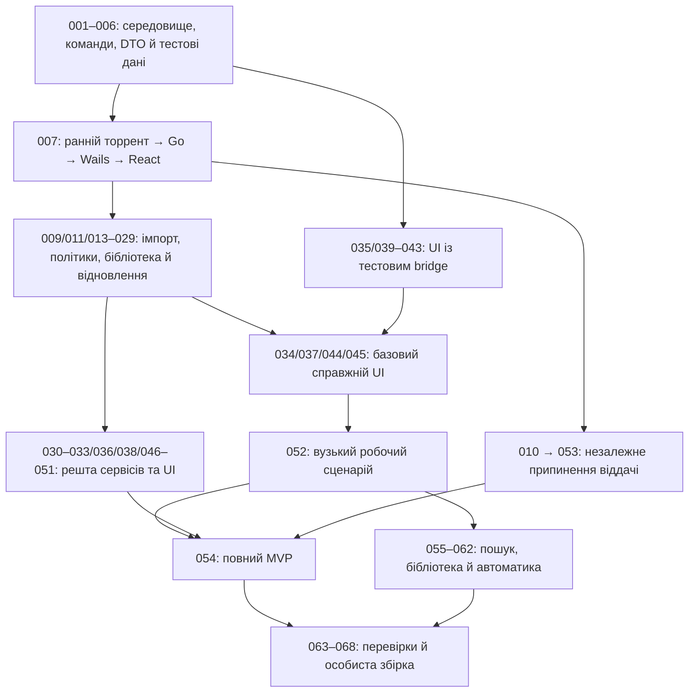

# OctopusTorrent — детальний план розробки

**Дата:** 14 жовтня 2026. **Редакція плану:** 3 — TDD, 100% покриття й архітектурна дисципліна. **Поточний стан:** документація й інтерактивний макет; реалізацію та прототипи цей план не виконує. Усі 68 задач мають статус `planned`.

План охоплює **8 фаз, 68 виконавчих задач, усі 80 ID вимог і 19 наскрізних сценаріїв**. Номери сталі, а порядок старту визначають обов’язкові залежності. Задачу 052 можна виконувати до 030–033 та частини UI-задач; числовий порядок не є наказом виконати спочатку всі менші номери. Спершу доводимо ризикові контракти рушія, збереження й macOS. Потім складаємо працездатний основний сценарій, повний MVP, погоджену бібліотеку й автоматику. Завершуємо перевіреною особистою збіркою та передачею контексту. Перевірки функції виконуються разом із нею; фінальні фази досліджують взаємодію й залишкові ризики.

## Стек, обсяг і джерело правди

| Частина | Рішення |
|---|---|
| Інтерфейс | React + TypeScript strict, Vite |
| Desktop / зв’язок Go–TS | Wails v2, системний macOS WebView |
| Логіка та файлові операції | Go |
| BitTorrent | anacrolix/torrent |
| Локальна бібліотека | SQLite через repository |

Ціль — особистий локальний застосунок на власному Apple Silicon Mac. Мережа потрібна для BitTorrent; бібліотека й налаштування локальні. Акаунти, підписки, платежі, сервер ліцензій, хмарна синхронізація, аналітика, телевізійний стрімінг, каталог контенту, хмарний CI й випуски інших платформ не входять у роботу. **AI-first означає читабельний код і відтворюваний контекст у репозиторії; модель ШІ всередині застосунку не потрібна.**

Авторитетність документів:

1. [PROJECT_REQUIREMENTS.md](../PROJECT_REQUIREMENTS.md) — поведінка, критерії, 80 ID і 19 сценаріїв.
2. [PRODUCT_CONCEPT.md](../PRODUCT_CONCEPT.md) — ідея, особисті межі й погоджені наступні можливості.
3. [APPLICATION_ARCHITECTURE.md](../APPLICATION_ARCHITECTURE.md) — компоненти, DTO, життєві цикли й безпека даних.
4. [ANACROLIX_TORRENT_TECHNICAL_RESEARCH.md](../ANACROLIX_TORRENT_TECHNICAL_RESEARCH.md) — документація API та непідтверджені прототипом припущення.
5. [HTML-макет](../MOCKUP.html) — орієнтир оформлення й взаємодій. Демонстраційні перемикачі не переносяться у продукт.
6. [Обов’язкова інженерна політика](../docs/engineering/TDD_AND_QUALITY.md), [AGENTS.md](../AGENTS.md) та [документація фіч](../docs/README.md) застосовуються до кожної сесії.
7. Цей README і numbered tasks — спосіб виконання, а не мовчазна зміна вимог. Старий libtorrent у `archive/` — історична довідка, не поточний рушій.

Шляхи `internal/`, `frontend/`, `docs/`, `scripts/` — **запропоновані місця майбутнього коду**. [001](001-scope-and-decision-register.md) перевіряє й визначає фактичний каталог; [002](002-repository-and-agent-entrypoint.md) створює точку входу. Синхронізовані ChatGPT `sources/` залишаються лише для читання.

## Обов’язкові правила кожної сесії й зміни

**TDD → 100% покриття → рефакторинг → актуальна документація → відсутність боргу** є умовами кожної задачі, включно з ранніми прототипами. На початку кожної сесії агент читає архітектуру й фактичний код, планує вплив і повторне використання та записує план до редагування. Детальні метрики й межі вимірювання — у [політиці](../docs/engineering/TDD_AND_QUALITY.md); правила входу — в [AGENTS.md](../AGENTS.md).

RED фіксує потрібну невдалу перевірку до реалізації; GREEN відновлює правильну поведінку та 100%; REFACTOR прибирає дублювання й неправильні межі на зелених тестах. Відкладений тест, обхід порога, неактуальний документ фічі чи залишений потрібний тимчасовий код забороняють `done`. До появи виконуваного коду coverage — `not_applicable`, а не вигадані 100%.

## Як виконати одну задачу

1. Прочитати README, AGENTS.md, інженерну політику, вимоги й архітектуру; у кожній сесії проаналізувати фактичний код, повторне використання та потрібний рефакторинг, записати план до змін.
2. Вибрати `planned` задачу, усі обов’язкові залежності якої `done` з потрібним доказом. Незалежний UI можна готувати через тестовий bridge після контрактів.
3. Пройти умови початку нижче. Змінити статус на `in_progress` у файлі й навігації одночасно.
4. Виконати предметні кроки через RED → GREEN → REFACTOR. Спершу тест потрібної поведінки, потім мінімальна реалізація й 100% покриття, далі рефакторинг і повторний зелений прогін. Документ фічі оновлюється одночасно.
5. Виконати фактичні команди з кореневого README/[004](004-reproducible-check-commands.md); записати версію коду/збірки, тестові дані й результат. Початкові ручні задачі не потребують майбутнього засобу запуску перевірок.
6. Пройти критерії приймання й умови завершення. Оновити рішення, контракти й команди та записати передачу контексту.
7. Позначити `done` тільки з доказом; невдала залежна перевірка або відсутнє рішення дає `blocked` із причиною. Часткова готовність не означає виконання всієї вимоги.

### Облік без дублювання

Файл кожної задачі — джерело її назви, статусу, фази й обов’язкових залежностей. Навігаційна таблиця нижче відтворює ці поля. До появи локального засобу з 004 її оновлюють вручну разом із задачею та перевіряють відповідність; після цього — генерують лише позначений блок. Матриці основних відповідальних задач і приймальних сценаріїв підтримуються окремо за змістом.

Завершення задачі не означає автоматичного завершення всіх її ID вимог. Для приймання вимоги потрібні всі відповідні сервісні, UI й інтеграційні докази. Наприклад, 005 описує контракт, 035 перевіряє його в React, а 034/052 доводять реальний зв’язок.

### Статуси й передача контексту

| Статус | Значення |
|---|---|
| `planned` | До реалізації не приступали; кроки й тести є планом. |
| `in_progress` | Задача виконується, ще не пройдено всі критерії. |
| `blocked` | Є конкретна перешкода: залежність, невдала перевірка або невирішений контракт; записати спосіб розблокування. |
| `done` | Критерії й перевірки виконані, докази збережені, документи та статуси узгоджені. |

Для перевірок окремо записуються `pass`, `fail`, `not_run`; це не статуси задач. Для негативного прототипу окремо записати результат досліду й стан продуктової контрольної перевірки: `pass`, `fail` або `unresolved`. Якщо критерій задачі вимагає працездатної поведінки, її статус лишається `blocked`, доки немає перевіреного рішення. Завершений звіт сам по собі не розблоковує залежну функцію. У звіті назвати конкретні незалежні задачі, які можна продовжувати. TODO має причину та критерій закриття. Передача контексту містить мету й зміни, фактичні модулі, команди/результати, ADR, обмеження та наступні готові задачі. Потрібні пояснення не залишаються тільки в чаті.

### Умови початку задачі

- Обсяг, ID вимог і один перевірюваний результат зрозумілі.
- Залежності завершені на потрібній межі: читання API не підмінює експериментальний доказ.
- Модулі, контракти й тестові дані знайдені; інструменти/команди відомі або саме ця задача їх створює.
- Відкрите рішення належить цій або конкретній попередній задачі. Небезпечний дослід використовує тільки власні штучні файли.
- Валідація, скасування, стан помилки й спостережуваний результат продумані до коду.

### Умови завершення задачі

- Критерії доведені через TDD, потрібна регресія зелена, а власний виконуваний код має точне 100% визначених метрик із повним інвентарем джерел.
- Архітектурний план сесії й фактичний вплив звірені; рефакторинг зачепленого сценарію завершений, новий і зачеплений потрібний борг не відкладені.
- docs/features/<feature>.md та індекс актуальні; невиконані тести, документація й тимчасові обходи блокують завершення.
- Звіт містить дату, версію зміни й виконані перевірки. Для мережевих, файлових і системних дослідів додати версії, Mac/конфігурацію, тестові дані, точні команди та спостереження. Для зміни документа спочатку перевірити потрібний новий стан, потім змінити й повторно перевірити структуру/посилання. Мережевий тест без зв’язку зі зміною не потрібний; доказом є її перевірюваний результат.
- Go-тести доводять інваріанти, справжній рушій — байти/трафік, repository — SQLite, тестовий bridge — UI, зібрана .app — macOS інтеграцію.
- Ресурси завершуються, дані захищені, а AppError не приховує помилку як успіх.
- Оновлені саме зачеплені README/AGENTS/ADR/API; новий ADR потрібний для рішення, а не для кожної зміни кольору. Bindings відтворюються, якщо змінився контракт.
- Для нової UI-функції додані її тексти шістьма мовами, зрозуміла помилка й клавіатурна дія. Базова 041 не підмінює майбутню локалізацію всіх екранів.
- Статуси task/README синхронні; наступному агенту достатньо репозиторію.

Кожна зміна проходить TDD та визначені 100% покриття. Візуальні перевірки доповнюють тести поведінки й не скасовують поріг; тести мають перевіряти результат, а не копію реалізації. Оцінка розміру якісна, без вигаданих годин: незалежно перевірювану частину можна виділити в нову numbered task з оновленням залежностей і матриць.

## Фази й критерії переходу

| Фаза | Задачі | Результат переходу |
|---|---|---|
| P0 — Контекст і старт репозиторію | 001–002 | Обсяг, каталог коду, README/AGENTS і реєстр рішень визначені. |
| P1 — Прототипи ризикових контрактів | 003–012 | 007 рано доводить справжній шлях торрент → Go → Wails → React; решта дослідів окремо перевіряє збереження, magnet, віддачу й Смітник. Відмова Смітника не блокує звичайний імпорт. |
| P2 — Типи, дані й межі сервісів | 013–018 | Політика, схема, repository, діагностика й адаптер перевірені; UI, SQL і рушій не змішані. |
| P3 — Імпорт, передавання й безпека даних | 019–033 | Сервісний сценарій імпорту, передавання, перезапуску й видалення працює на контрольованому рушії. |
| P4 — React UI й macOS інтеграція | 034–051 | Базові bindings і UI дозволяють перейти до 052, не чекаючи всіх додаткових команд. Решта UI додається поступово й обов’язкова для 054. |
| P5 — Основний сценарій і повний MVP | 052–054 | 052 перевіряє вузький збережений сценарій без групового видалення/Finder/Смітника. 054 додатково приймає всі ці можливості й незалежне вимкнення віддачі. |
| P6 — Бібліотека й локальна автоматизація | 055–062 | Пошук, фільтри, колекції, правила й спостереження працюють; автоматичні записи на паузі, джерела збережені. |
| P7 — Надійність, особиста збірка й передача | 063–068 | 80 вимог і 19 сценаріїв мають докази; .app встановлено, репозиторій придатний для нового агента. |

Фази — логічне групування, не бар’єри незалежній роботі. Наприклад, React bridge/компоненти можна готувати, поки досліджуються Go storage/metadata, якщо 005 уже готова. **007 — ранній тимчасовий наскрізний прототип; 052 — робочий сценарій зі збереженням і відновленням; 054 — весь погоджений MVP; 068 — увесь обсяг, включно з NEXT/COL/AUTO.**

## Граф основних потоків

Це огляд можливостей, а не точний граф кожного номера. Обов’язкові залежності наведені в таблиці. Тривалість задач ще не виміряна, тому це не оцінка строків і не розрахований за часом критичний шлях.

### Рекомендований маршрут до першого результату

1. **Налаштування:** 001 → 002 → 003; потім незалежно 004 і 005.
2. **Перша справжня інтеграція:** 006 → 007. Власник уже бачить справжній поступ у Wails-вікні; результат експериментальний, без обіцянки готової бібліотеки.
3. **Надійне ядро:** виконати передумови 009/011/013–029. Одночасно можна готувати 035/039–043 з тестовим bridge.
4. **Ранній робочий маршрут:** 034/037/040/044/045 та 029 → 052. Не чекати 030–033, Finder, перетягування чи всієї панелі налаштувань.
5. **Повний MVP:** решта сервісів/UI та доведені 010/053 → 054. Блокування незалежної віддачі не приховує готовність 052, але не дозволяє назвати весь MVP завершеним.
6. **Погоджене розширення й завершення:** 055–062, незалежні перевірки 063/064/065, потім 066–068. Колекції не є технічною передумовою редагування правил, а перевірка VoiceOver не повинна чекати тривалого профілювання.

### Паралельна робота без конфліктів

| Потік | Можна почати | Власні файли | Інтеграція |
|---|---|---|---|
| Go рушій/файли | Після 005/006/007 за залежностями | `internal/torrentengine`, `internal/files`, тестові дані | Узгоджені DTO до 034 |
| Go repository/сервіси | Після 008/013 | `internal/library`, migrations, `internal/app` | Контракт 005, адаптер 018, імпорт 023 |
| React підготовка | Після 005 з тестовим bridge | `frontend/src/bridge/state/styles/features` | Реальний facade 034 і залежності функцій |
| Системна оболонка | Після 003 й потрібних сервісних контрактів | `internal/platform`, bundle metadata | Справжня .app, не тільки браузер |

Це спосіб організації, не вимога запускати додаткових агентів. Одночасні виконавці узгоджують власність файлів. `go.mod`, schema/migrations, DTO, `wails.json` і generated bindings у конкретній роботі змінює один відповідальний; інші пропонують точну зміну контракту. Спільний workspace не створює приватних копій файлів.

## Навігація всіх задач

<!-- TASKS-NAV:BEGIN -->
| ID / файл | Завдання | Фаза | Обов’язкові залежності | Вимоги | Статус |
|---|---|---|---|---|---|
| [001](001-scope-and-decision-register.md) | Зафіксувати вихідний обсяг і відкриті рішення | P0 | — | AI-06, DATA-01, QA-07 | `done` |
| [002](002-repository-and-agent-entrypoint.md) | Підготувати Git-репозиторій і точку входу для АІ | P0 | [001](001-scope-and-decision-register.md) | AI-01, AI-02, AI-03, AI-04, AI-09, QA-01, QA-03, QA-04, QA-07, QA-08 | `done` |
| [003](003-wails-macos-build-spike.md) | Зібрати першу Wails .app на власному Mac | P1 | [002](002-repository-and-agent-entrypoint.md) | REL-01, REL-02, STACK-05, UI-04, AI-07, QA-01, QA-02, QA-05 | `planned` |
| [004](004-reproducible-check-commands.md) | Зафіксувати команди збірки й локальних перевірок | P1 | [003](003-wails-macos-build-spike.md) | AI-07, AI-08, QA-01, QA-02, QA-05 | `planned` |
| [005](005-domain-dto-and-bridge-contract.md) | Описати власні Go–TS контракти й помилки | P1 | [003](003-wails-macos-build-spike.md) | AI-05, AI-02, STACK-01, STACK-02, STACK-03 | `planned` |
| [006](006-controlled-torrent-fixtures.md) | Створити контрольовані торренти й локальний swarm | P1 | [004](004-reproducible-check-commands.md) | AI-08, TR-02 | `planned` |
| [007](007-engine-api-lifecycle-spike.md) | Перевірити API та життєвий цикл anacrolix на одній версії | P1 | [006](006-controlled-torrent-fixtures.md), [005](005-domain-dto-and-bridge-contract.md) | AI-05, AI-07, STACK-03 | `planned` |
| [008](008-sqlite-driver-durability-spike.md) | Вибрати SQLite-драйвер і режим збереження даних | P1 | [004](004-reproducible-check-commands.md) | STACK-04, SET-02, AI-07 | `planned` |
| [009](009-storage-and-completion-spike.md) | Перевірити розташування файлів і збереження стану перевірених частин | P1 | [007](007-engine-api-lifecycle-spike.md), [008](008-sqlite-driver-durability-spike.md) | SET-02, TR-05, ADD-04 | `planned` |
| [010](010-upload-stop-and-pause-spike.md) | Виміряти припинення віддачі без зупинки завантаження | P1 | [007](007-engine-api-lifecycle-spike.md) | TR-01, TR-08, SET-08 | `planned` |
| [011](011-magnet-metadata-storage-spike.md) | Перевірити отримання magnet-метаданих і остаточну папку файлів | P1 | [009](009-storage-and-completion-spike.md) | ADD-02, ADD-04, ADD-07 | `planned` |
| [012](012-macos-trash-and-path-spike.md) | Перевірити Кошик macOS і захист файлових шляхів | P1 | [003](003-wails-macos-build-spike.md), [007](007-engine-api-lifecycle-spike.md) | DEL-02, DEL-04, STACK-01 | `planned` |
| [013](013-transfer-policy-state-machine.md) | Описати стани й політику передавання торрента | P2 | [005](005-domain-dto-and-bridge-contract.md), [007](007-engine-api-lifecycle-spike.md) | TR-01, TR-03, STACK-03, AI-04 | `planned` |
| [014](014-sqlite-schema-migrations.md) | Створити схему SQLite й безпечні міграції | P2 | [005](005-domain-dto-and-bridge-contract.md), [008](008-sqlite-driver-durability-spike.md) | STACK-04, SET-02 | `planned` |
| [015](015-transactional-repositories.md) | Ізолювати SQL і забезпечити транзакційний запис | P2 | [014](014-sqlite-schema-migrations.md), [013](013-transfer-policy-state-machine.md) | STACK-04, SET-02, DATA-01 | `planned` |
| [016](016-migration-backup-corruption-recovery.md) | Захистити бібліотеку від помилок міграції й пошкодження БД | P2 | [015](015-transactional-repositories.md) | SET-02, DATA-01, STACK-04 | `planned` |
| [017](017-local-diagnostics-privacy.md) | Створити локальну діагностику із захистом приватних даних | P2 | [005](005-domain-dto-and-bridge-contract.md), [004](004-reproducible-check-commands.md) | DATA-02, DATA-03 | `planned` |
| [018](018-torrent-engine-adapter.md) | Створити адаптер торрент-рушія з явним керуванням ресурсами | P2 | [007](007-engine-api-lifecycle-spike.md), [005](005-domain-dto-and-bridge-contract.md), [013](013-transfer-policy-state-machine.md) | AI-03, AI-04, AI-05, STACK-01, QA-03, QA-08 | `planned` |
| [019](019-metainfo-parser-file-tree.md) | Розібрати метадані й побудувати узгоджене дерево файлів | P3 | [018](018-torrent-engine-adapter.md), [006](006-controlled-torrent-fixtures.md) | ADD-01, ADD-04, ADD-09, UI-18, STACK-01 | `planned` |
| [020](020-destination-filesystem-service.md) | Реалізувати вибір папок і перевірений план файлових шляхів | P3 | [009](009-storage-and-completion-spike.md), [019](019-metainfo-parser-file-tree.md), [015](015-transactional-repositories.md) | ADD-04, ADD-08, SET-01, SET-05, STACK-01 | `planned` |
| [021](021-full-hash-deduplication.md) | Уникати дублікатів за повними хешами торрентів | P3 | [019](019-metainfo-parser-file-tree.md), [015](015-transactional-repositories.md) | ADD-03, STACK-03, SET-02 | `planned` |
| [022](022-pending-import-coordinator.md) | Створити єдиний координатор незавершених імпортів | P3 | [011](011-magnet-metadata-storage-spike.md), [019](019-metainfo-parser-file-tree.md), [020](020-destination-filesystem-service.md), [021](021-full-hash-deduplication.md) | ADD-01, ADD-02, ADD-06, ADD-07, STACK-03 | `planned` |
| [023](023-durable-import-commit.md) | Зберегти імпорт і політики до початку передавання файлів | P3 | [022](022-pending-import-coordinator.md), [015](015-transactional-repositories.md), [013](013-transfer-policy-state-machine.md), [009](009-storage-and-completion-spike.md) | ADD-04, ADD-07, SET-02, STACK-04 | `planned` |
| [024](024-file-folder-wanted-commands.md) | Керувати вибором файлів і всіх нащадків папки | P3 | [023](023-durable-import-commit.md), [013](013-transfer-policy-state-machine.md) | TR-06, TR-07, UI-09, UI-18 | `planned` |
| [025](025-pause-resume-application.md) | Реалізувати запуск і ручну паузу торрентів | P3 | [023](023-durable-import-commit.md), [013](013-transfer-policy-state-machine.md), [018](018-torrent-engine-adapter.md) | TR-01, STACK-03 | `planned` |
| [026](026-rate-limits-seed-network.md) | Реалізувати загальні ліміти, роздачу й відновлення мережі | P3 | [025](025-pause-resume-application.md), [015](015-transactional-repositories.md) | TR-03, TR-04, TR-05 | `planned` |
| [027](027-metrics-status-snapshots.md) | Публікувати точні знімки прогресу й стану | P3 | [024](024-file-folder-wanted-commands.md), [025](025-pause-resume-application.md), [026](026-rate-limits-seed-network.md), [005](005-domain-dto-and-bridge-contract.md) | TR-02, UI-01, UI-02, UI-08, UI-12, UI-19, STACK-02 | `planned` |
| [028](028-application-startup-quit.md) | Реалізувати запуск, один екземпляр і завершення .app | P3 | [018](018-torrent-engine-adapter.md), [015](015-transactional-repositories.md), [017](017-local-diagnostics-privacy.md), [003](003-wails-macos-build-spike.md) | SET-02, STACK-05, DATA-01 | `planned` |
| [029](029-restore-recheck-reconciliation.md) | Відновити бібліотеку після перезапуску й аварії | P3 | [028](028-application-startup-quit.md), [023](023-durable-import-commit.md), [024](024-file-folder-wanted-commands.md), [027](027-metrics-status-snapshots.md), [016](016-migration-backup-corruption-recovery.md), [009](009-storage-and-completion-spike.md) | SET-02, TR-05, DATA-01 | `planned` |
| [030](030-relink-missing-payload.md) | Повторно вибрати розташування зниклих даних | P3 | [029](029-restore-recheck-reconciliation.md), [020](020-destination-filesystem-service.md) | SET-03, TR-05 | `planned` |
| [031](031-delete-record-lifecycle.md) | Видалити запис зі збереженням файлів | P3 | [029](029-restore-recheck-reconciliation.md), [025](025-pause-resume-application.md) | DEL-01, DEL-03, STACK-03 | `planned` |
| [032](032-safe-payload-trash-journal.md) | Безпечно перемістити підтверджені файли у Смітник | P3 | [031](031-delete-record-lifecycle.md), [020](020-destination-filesystem-service.md), [012](012-macos-trash-and-path-spike.md) | DEL-02, DEL-04, DEL-05, STACK-01 | `planned` |
| [033](033-bulk-command-service.md) | Виконувати групові команди з частковими результатами | P3 | [025](025-pause-resume-application.md), [031](031-delete-record-lifecycle.md), [032](032-safe-payload-trash-journal.md) | UI-07, DEL-05, STACK-03 | `planned` |
| [034](034-wails-facade-real-bindings.md) | Під’єднати Go-сервіси до справжніх Wails bindings | P4 | [027](027-metrics-status-snapshots.md), [028](028-application-startup-quit.md) | STACK-01, AI-05 | `planned` |
| [035](035-react-bridge-state-resync.md) | Реалізувати React bridge і відновлення знімків | P4 | [005](005-domain-dto-and-bridge-contract.md), [004](004-reproducible-check-commands.md) | STACK-02, AI-04, AI-08 | `planned` |
| [036](036-finder-magnet-open-queue.md) | Підтримати Finder і системне відкривання magnet | P4 | [034](034-wails-facade-real-bindings.md), [022](022-pending-import-coordinator.md) | ADD-01, ADD-02, SET-07, STACK-05 | `planned` |
| [037](037-native-dialogs-clipboard.md) | Реалізувати системні діалоги й копіювання повного шляху | P4 | [034](034-wails-facade-real-bindings.md), [020](020-destination-filesystem-service.md) | ADD-01, ADD-04, ADD-08, SET-01, SET-03, SET-05, UI-12 | `planned` |
| [038](038-native-drop-menus-shortcuts.md) | Додати системне перетягування, меню й клавіатуру | P4 | [034](034-wails-facade-real-bindings.md), [036](036-finder-magnet-open-queue.md), [037](037-native-dialogs-clipboard.md) | ADD-06, UI-04, UI-17 | `planned` |
| [039](039-visual-primitives-tokens.md) | Перенести дизайн-токени й базові компоненти | P4 | [003](003-wails-macos-build-spike.md), [005](005-domain-dto-and-bridge-contract.md) | UI-06, UI-04, UI-15, AI-03, QA-01, QA-02, QA-03 | `planned` |
| [040](040-app-shell-fixed-geometry.md) | Побудувати стабільне вікно з незалежним прокручуванням | P4 | [035](035-react-bridge-state-resync.md), [039](039-visual-primitives-tokens.md) | UI-16, UI-17, UI-06 | `planned` |
| [041](041-six-languages-formatters.md) | Реалізувати шість мов і форматування даних | P4 | [035](035-react-bridge-state-resync.md), [039](039-visual-primitives-tokens.md), [015](015-transactional-repositories.md) | SET-06, UI-12, REL-03 | `planned` |
| [042](042-appearance-theme-opaque.md) | Підтримати теми й непрозорий вигляд | P4 | [040](040-app-shell-fixed-geometry.md), [015](015-transactional-repositories.md) | SET-04, UI-06, UI-04 | `planned` |
| [043](043-modal-focus-operations.md) | Реалізувати модальні діалоги, фокус і скасування | P4 | [035](035-react-bridge-state-resync.md), [039](039-visual-primitives-tokens.md), [041](041-six-languages-formatters.md) | UI-04, ADD-07, DEL-02 | `planned` |
| [044](044-import-preview-ui-tree.md) | Побудувати попередній перегляд додавання з деревом | P4 | [043](043-modal-focus-operations.md), [037](037-native-dialogs-clipboard.md), [022](022-pending-import-coordinator.md), [023](023-durable-import-commit.md) | ADD-01, ADD-02, ADD-04, ADD-07, ADD-08, ADD-09 | `planned` |
| [045](045-torrent-cards-status-actions.md) | Побудувати картки, статуси й основні дії | P4 | [040](040-app-shell-fixed-geometry.md), [041](041-six-languages-formatters.md), [027](027-metrics-status-snapshots.md), [025](025-pause-resume-application.md) | UI-01, UI-08, UI-13, UI-19, UI-12, UI-15 | `planned` |
| [046](046-post-import-file-folder-tree.md) | Побудувати дерево кнопок файлів і папок | P4 | [044](044-import-preview-ui-tree.md), [024](024-file-folder-wanted-commands.md), [045](045-torrent-cards-status-actions.md) | UI-09, UI-11, UI-18, TR-06, TR-07 | `planned` |
| [047](047-inspector-full-path-recovery.md) | Побудувати деталі, повний шлях і пошук зниклих даних | P4 | [046](046-post-import-file-folder-tree.md), [037](037-native-dialogs-clipboard.md), [030](030-relink-missing-payload.md) | UI-02, UI-11, UI-12, UI-15, SET-03 | `planned` |
| [048](048-persistent-bulk-selection-ui.md) | Реалізувати постійний груповий вибір | P4 | [045](045-torrent-cards-status-actions.md), [033](033-bulk-command-service.md), [043](043-modal-focus-operations.md) | UI-07, DEL-05 | `planned` |
| [049](049-delete-confirmation-result-ui.md) | Підтвердити видалення й показати часткові результати | P4 | [048](048-persistent-bulk-selection-ui.md), [047](047-inspector-full-path-recovery.md), [032](032-safe-payload-trash-journal.md) | DEL-01, DEL-02, DEL-04, DEL-05, UI-13 | `planned` |
| [050](050-settings-ui-save-feedback.md) | Побудувати налаштування з правдивим результатом збереження | P4 | [037](037-native-dialogs-clipboard.md), [041](041-six-languages-formatters.md), [042](042-appearance-theme-opaque.md), [026](026-rate-limits-seed-network.md), [015](015-transactional-repositories.md) | SET-01, SET-04, SET-05, SET-06, SET-07, TR-04 | `planned` |
| [051](051-offline-errors-notifications.md) | Показувати помилки, відсутність мережі й повтор операції | P4 | [045](045-torrent-cards-status-actions.md), [047](047-inspector-full-path-recovery.md), [017](017-local-diagnostics-privacy.md), [029](029-restore-recheck-reconciliation.md), [041](041-six-languages-formatters.md) | UI-03, UI-10, DATA-01, DATA-03, TR-05 | `planned` |
| [052](052-first-working-core-gate.md) | Прийняти перший працездатний наскрізний сценарій | P5 | [034](034-wails-facade-real-bindings.md), [035](035-react-bridge-state-resync.md), [040](040-app-shell-fixed-geometry.md), [044](044-import-preview-ui-tree.md), [045](045-torrent-cards-status-actions.md), [029](029-restore-recheck-reconciliation.md) | AI-08, STACK-05, TR-02 | `planned` |
| [053](053-global-upload-policy-production.md) | Реалізувати незалежне глобальне вимкнення віддачі | P5 | [010](010-upload-stop-and-pause-spike.md), [025](025-pause-resume-application.md), [026](026-rate-limits-seed-network.md), [029](029-restore-recheck-reconciliation.md), [015](015-transactional-repositories.md) | TR-08, SET-08 | `planned` |
| [054](054-global-upload-ui-mvp-gate.md) | Завершити налаштування віддачі й прийняти повний MVP | P5 | [053](053-global-upload-policy-production.md), [052](052-first-working-core-gate.md), [036](036-finder-magnet-open-queue.md), [038](038-native-drop-menus-shortcuts.md), [046](046-post-import-file-folder-tree.md), [047](047-inspector-full-path-recovery.md), [048](048-persistent-bulk-selection-ui.md), [049](049-delete-confirmation-result-ui.md), [050](050-settings-ui-save-feedback.md), [051](051-offline-errors-notifications.md) | SET-08, TR-08, AI-08 | `planned` |
| [055](055-search-status-filters.md) | Додати пошук і фільтри станів | P6 | [040](040-app-shell-fixed-geometry.md), [048](048-persistent-bulk-selection-ui.md), [027](027-metrics-status-snapshots.md) | NEXT-01, NEXT-02, UI-07, UI-16 | `planned` |
| [056](056-local-tags-crud.md) | Реалізувати локальні теги | P6 | [052](052-first-working-core-gate.md), [015](015-transactional-repositories.md), [034](034-wails-facade-real-bindings.md), [041](041-six-languages-formatters.md) | COL-01 | `planned` |
| [057](057-smart-collections.md) | Реалізувати розумні колекції | P6 | [056](056-local-tags-crud.md), [055](055-search-status-filters.md) | COL-01 | `planned` |
| [058](058-rules-semantics-preview-evaluator.md) | Узгодити правила й обчислити їхній попередній результат | P6 | [056](056-local-tags-crud.md), [022](022-pending-import-coordinator.md), [020](020-destination-filesystem-service.md) | AUTO-02 | `planned` |
| [059](059-rules-crud-import-application.md) | Зберегти правила й застосувати при імпорті | P6 | [058](058-rules-semantics-preview-evaluator.md), [023](023-durable-import-commit.md), [050](050-settings-ui-save-feedback.md) | AUTO-02 | `planned` |
| [060](060-watch-folder-stable-detection.md) | Надійно спостерігати за новими .torrent | P6 | [028](028-application-startup-quit.md), [019](019-metainfo-parser-file-tree.md), [021](021-full-hash-deduplication.md), [020](020-destination-filesystem-service.md) | AUTO-01 | `planned` |
| [061](061-watch-folder-settings-queue-ui.md) | Налаштувати перегляд і автоматичне додавання на паузі | P6 | [060](060-watch-folder-stable-detection.md), [059](059-rules-crud-import-application.md), [044](044-import-preview-ui-tree.md), [050](050-settings-ui-save-feedback.md) | AUTO-01, AUTO-02 | `planned` |
| [062](062-automation-end-to-end-gate.md) | Прийняти колекції, правила й папку спостереження | P6 | [057](057-smart-collections.md), [061](061-watch-folder-settings-queue-ui.md), [055](055-search-status-filters.md) | COL-01, AUTO-01, AUTO-02, AI-08 | `planned` |
| [063](063-failure-race-fuzz-regression.md) | Перевірити збої, гонки й аварійне відновлення | P7 | [054](054-global-upload-ui-mvp-gate.md), [062](062-automation-end-to-end-gate.md), [032](032-safe-payload-trash-journal.md), [029](029-restore-recheck-reconciliation.md) | AI-08, STACK-03, STACK-04, TR-05, DEL-04, QA-02, QA-05, QA-06, QA-08 | `planned` |
| [064](064-scale-profiling-lifecycle-soak.md) | Виміряти великі бібліотеки й тривалу роботу | P7 | [062](062-automation-end-to-end-gate.md), [054](054-global-upload-ui-mvp-gate.md), [040](040-app-shell-fixed-geometry.md), [046](046-post-import-file-folder-tree.md), [027](027-metrics-status-snapshots.md) | UI-16, UI-15, STACK-02, AI-08 | `planned` |
| [065](065-native-accessibility-language-gate.md) | Перевірити клавіатуру, VoiceOver й macOS WebView | P7 | [054](054-global-upload-ui-mvp-gate.md), [062](062-automation-end-to-end-gate.md), [041](041-six-languages-formatters.md), [042](042-appearance-theme-opaque.md) | UI-04, UI-06, SET-06, SET-04, STACK-05 | `planned` |
| [066](066-personal-build-install-license-audit.md) | Зібрати й встановити особистий реліз | P7 | [063](063-failure-race-fuzz-regression.md), [064](064-scale-profiling-lifecycle-soak.md), [065](065-native-accessibility-language-gate.md) | REL-01, REL-02, STACK-05, DATA-02 | `planned` |
| [067](067-owner-help-upgrade-recovery-runbook.md) | Написати локальну довідку й процедуру відновлення | P7 | [066](066-personal-build-install-license-audit.md), [062](062-automation-end-to-end-gate.md), [029](029-restore-recheck-reconciliation.md) | REL-03, AI-06, AI-09, QA-04 | `planned` |
| [068](068-full-acceptance-clean-context-handoff.md) | Закрити всі вимоги й передати проєкт без чату | P7 | [067](067-owner-help-upgrade-recovery-runbook.md), [063](063-failure-race-fuzz-regression.md), [064](064-scale-profiling-lifecycle-soak.md), [065](065-native-accessibility-language-gate.md), [066](066-personal-build-install-license-audit.md) | AI-10, AI-01, AI-09, AI-08, QA-01, QA-02, QA-03, QA-04, QA-05, QA-06, QA-07, QA-08 | `planned` |
<!-- TASKS-NAV:END -->

## Повне покриття 80 вимог

Основна задача відповідає за закриття цілого критерію й збирає докази суміжних частин: UI, рушія, БД та macOS. Вона не обов’язково реалізує всі модулі сама. Колонка перевірки показує повторне приймання. Усі критерії ще **planned**; згадка ID не означає реалізацію.

| ID | Вимога | Основна задача | Перевірка |
|---|---|---|---|
| ADD-01 | Додавати локальний файл `.torrent` через кнопку у застосунку, команду «Відкрити за допомогою» та подвійне натискання у Finder, якщо користувач призначив OctopusTorrent типовим застосунком. | [022](022-pending-import-coordinator.md) | [036](036-finder-magnet-open-queue.md), [038](038-native-drop-menus-shortcuts.md), [066](066-personal-build-install-license-audit.md), [068](068-full-acceptance-clean-context-handoff.md) |
| ADD-02 | Додавати magnet-посилання вставленням у застосунку та системним відкриттям посилання. | [022](022-pending-import-coordinator.md) | [036](036-finder-magnet-open-queue.md), [038](038-native-drop-menus-shortcuts.md), [066](066-personal-build-install-license-audit.md), [068](068-full-acceptance-clean-context-handoff.md) |
| ADD-03 | Не створювати дублікат уже доданого торрента. | [021](021-full-hash-deduplication.md) | [052 — частково](052-first-working-core-gate.md), [054](054-global-upload-ui-mvp-gate.md), [063](063-failure-race-fuzz-regression.md), [068](068-full-acceptance-clean-context-handoff.md) |
| ADD-04 | До старту дозволяти вибрати папку призначення та файли для завантаження. | [023](023-durable-import-commit.md) | [052 — частково](052-first-working-core-gate.md), [054](054-global-upload-ui-mvp-gate.md), [063](063-failure-race-fuzz-regression.md), [068](068-full-acceptance-clean-context-handoff.md) |
| ADD-06 | Приймати один `.torrent` перетягуванням у зону внизу бічної панелі. | [038](038-native-drop-menus-shortcuts.md) | [036](036-finder-magnet-open-queue.md), [038](038-native-drop-menus-shortcuts.md), [066](066-personal-build-install-license-audit.md), [068](068-full-acceptance-clean-context-handoff.md) |
| ADD-07 | Перед додаванням показувати діалог налаштування торрента. | [044](044-import-preview-ui-tree.md) | [052 — частково](052-first-working-core-gate.md), [054](054-global-upload-ui-mvp-gate.md), [063](063-failure-race-fuzz-regression.md), [068](068-full-acceptance-clean-context-handoff.md) |
| ADD-08 | У діалозі додавання дозволяти вибрати наявну папку або створити нову, задавши її назву та батьківську папку. | [020](020-destination-filesystem-service.md) | [052 — частково](052-first-working-core-gate.md), [054](054-global-upload-ui-mvp-gate.md), [063](063-failure-race-fuzz-regression.md), [068](068-full-acceptance-clean-context-handoff.md) |
| ADD-09 | Показувати вкладені папки у попередньому перегляді файлів. | [044](044-import-preview-ui-tree.md) | [052 — частково](052-first-working-core-gate.md), [054](054-global-upload-ui-mvp-gate.md), [063](063-failure-race-fuzz-regression.md), [068](068-full-acceptance-clean-context-handoff.md) |
| TR-01 | Запускати, призупиняти й відновлювати торрент. | [025](025-pause-resume-application.md) | [052 — частково](052-first-working-core-gate.md), [054](054-global-upload-ui-mvp-gate.md), [063](063-failure-race-fuzz-regression.md), [068](068-full-acceptance-clean-context-handoff.md) |
| TR-02 | Завантажувати вибрані файли й показувати поступ у реальному часі. | [027](027-metrics-status-snapshots.md) | [052 — частково](052-first-working-core-gate.md), [054](054-global-upload-ui-mvp-gate.md), [063](063-failure-race-fuzz-regression.md), [068](068-full-acceptance-clean-context-handoff.md) |
| TR-03 | Після завершення підтримувати роздачу. | [026](026-rate-limits-seed-network.md) | [052 — частково](052-first-working-core-gate.md), [054](054-global-upload-ui-mvp-gate.md), [063](063-failure-race-fuzz-regression.md), [068](068-full-acceptance-clean-context-handoff.md) |
| TR-04 | Надавати загальні налаштування максимальної швидкості завантаження та віддачі. | [026](026-rate-limits-seed-network.md) | [052 — частково](052-first-working-core-gate.md), [054](054-global-upload-ui-mvp-gate.md), [063](063-failure-race-fuzz-regression.md), [068](068-full-acceptance-clean-context-handoff.md) |
| TR-05 | Відновлювати роботу після втрати мережі або перезапуску застосунку. | [029](029-restore-recheck-reconciliation.md) | [052 — частково](052-first-working-core-gate.md), [054](054-global-upload-ui-mvp-gate.md), [063](063-failure-race-fuzz-regression.md), [068](068-full-acceptance-clean-context-handoff.md) |
| TR-06 | Дозволяти припинити подальше цільове завантаження окремого файла й знову його вибрати. | [024](024-file-folder-wanted-commands.md) | [052 — частково](052-first-working-core-gate.md), [054](054-global-upload-ui-mvp-gate.md), [063](063-failure-race-fuzz-regression.md), [068](068-full-acceptance-clean-context-handoff.md) |
| TR-07 | Дозволяти керування завантаженням для цілої папки. | [024](024-file-folder-wanted-commands.md) | [052 — частково](052-first-working-core-gate.md), [054](054-global-upload-ui-mvp-gate.md), [063](063-failure-race-fuzz-regression.md), [068](068-full-acceptance-clean-context-handoff.md) |
| TR-08 | Керувати віддачею глобально, незалежно від завантаження. | [053](053-global-upload-policy-production.md) | [010](010-upload-stop-and-pause-spike.md), [054](054-global-upload-ui-mvp-gate.md), [063](063-failure-race-fuzz-regression.md), [068](068-full-acceptance-clean-context-handoff.md) |
| UI-01 | Показувати список торрентів із назвою, статусом, прогресом, розміром та швидкістю. | [045](045-torrent-cards-status-actions.md) | [064](064-scale-profiling-lifecycle-soak.md), [065](065-native-accessibility-language-gate.md), [068](068-full-acceptance-clean-context-handoff.md) |
| UI-02 | Показувати деталі вибраного торрента. | [047](047-inspector-full-path-recovery.md) | [064](064-scale-profiling-lifecycle-soak.md), [065](065-native-accessibility-language-gate.md), [068](068-full-acceptance-clean-context-handoff.md) |
| UI-03 | Пояснювати порожній стан і помилки простою мовою. | [051](051-offline-errors-notifications.md) | [064](064-scale-profiling-lifecycle-soak.md), [065](065-native-accessibility-language-gate.md), [068](068-full-acceptance-clean-context-handoff.md) |
| UI-04 | Реалізувати інтерфейс на React + TypeScript у Wails. | [065](065-native-accessibility-language-gate.md) | [064](064-scale-profiling-lifecycle-soak.md), [065](065-native-accessibility-language-gate.md), [068](068-full-acceptance-clean-context-handoff.md) |
| UI-06 | Зберегти скляне оформлення бічної й верхньої панелей із макета. | [042](042-appearance-theme-opaque.md) | [064](064-scale-profiling-lifecycle-soak.md), [065](065-native-accessibility-language-gate.md), [068](068-full-acceptance-clean-context-handoff.md) |
| UI-07 | Дозволити вибрати кілька торрентів у розділі «Усі торренти» й виконати групову дію. | [048](048-persistent-bulk-selection-ui.md) | [064](064-scale-profiling-lifecycle-soak.md), [065](065-native-accessibility-language-gate.md), [068](068-full-acceptance-clean-context-handoff.md) |
| UI-08 | Показувати стан і швидкість безпосередньо в картці торрента. | [045](045-torrent-cards-status-actions.md) | [064](064-scale-profiling-lifecycle-soak.md), [065](065-native-accessibility-language-gate.md), [068](068-full-acceptance-clean-context-handoff.md) |
| UI-09 | Показувати кнопки play/pause біля кожного файла в картці та деталях. | [046](046-post-import-file-folder-tree.md) | [064](064-scale-profiling-lifecycle-soak.md), [065](065-native-accessibility-language-gate.md), [068](068-full-acceptance-clean-context-handoff.md) |
| UI-10 | Показувати помилки й відсутність мережі в окремій області під верхньою панеллю вікна. | [051](051-offline-errors-notifications.md) | [064](064-scale-profiling-lifecycle-soak.md), [065](065-native-accessibility-language-gate.md), [068](068-full-acceptance-clean-context-handoff.md) |
| UI-11 | Розгортати картку торрента та показувати файли також у панелі деталей. | [046](046-post-import-file-folder-tree.md) | [064](064-scale-profiling-lifecycle-soak.md), [065](065-native-accessibility-language-gate.md), [068](068-full-acceptance-clean-context-handoff.md) |
| UI-12 | Показувати обсяг і шлях так, щоб дані можна було прочитати та використати. | [047](047-inspector-full-path-recovery.md) | [064](064-scale-profiling-lifecycle-soak.md), [065](065-native-accessibility-language-gate.md), [068](068-full-acceptance-clean-context-handoff.md) |
| UI-13 | Дати основні дії біля самого торрента. | [045](045-torrent-cards-status-actions.md) | [064](064-scale-profiling-lifecycle-soak.md), [065](065-native-accessibility-language-gate.md), [068](068-full-acceptance-clean-context-handoff.md) |
| UI-15 | Обмежувати довгі значення у вузьких рядках. | [045](045-torrent-cards-status-actions.md) | [064](064-scale-profiling-lifecycle-soak.md), [065](065-native-accessibility-language-gate.md), [068](068-full-acceptance-clean-context-handoff.md) |
| UI-16 | Прокручувати довгі списки всередині вікна. | [040](040-app-shell-fixed-geometry.md) | [064](064-scale-profiling-lifecycle-soak.md), [065](065-native-accessibility-language-gate.md), [068](068-full-acceptance-clean-context-handoff.md) |
| UI-17 | Розмістити головну дію додавання у верхній панелі. | [040](040-app-shell-fixed-geometry.md) | [064](064-scale-profiling-lifecycle-soak.md), [065](065-native-accessibility-language-gate.md), [068](068-full-acceptance-clean-context-handoff.md) |
| UI-18 | Показувати файли торрента як дерево, якщо є папки. | [046](046-post-import-file-folder-tree.md) | [064](064-scale-profiling-lifecycle-soak.md), [065](065-native-accessibility-language-gate.md), [068](068-full-acceptance-clean-context-handoff.md) |
| UI-19 | Показувати напрямок або зупинку передавання на початку картки торрента. | [045](045-torrent-cards-status-actions.md) | [064](064-scale-profiling-lifecycle-soak.md), [065](065-native-accessibility-language-gate.md), [068](068-full-acceptance-clean-context-handoff.md) |
| DEL-01 | Окремо пропонувати «Видалити торрент зі списку» та «Видалити торрент і файли». | [031](031-delete-record-lifecycle.md) | [052 — частково](052-first-working-core-gate.md), [054](054-global-upload-ui-mvp-gate.md), [063](063-failure-race-fuzz-regression.md), [068](068-full-acceptance-clean-context-handoff.md) |
| DEL-02 | Перед видаленням файлів показувати підтвердження з переліком файлів і їхнім розташуванням. | [032](032-safe-payload-trash-journal.md) | [052 — частково](052-first-working-core-gate.md), [054](054-global-upload-ui-mvp-gate.md), [063](063-failure-race-fuzz-regression.md), [068](068-full-acceptance-clean-context-handoff.md) |
| DEL-03 | При видаленні запису зупиняти передавання. | [031](031-delete-record-lifecycle.md) | [052 — частково](052-first-working-core-gate.md), [054](054-global-upload-ui-mvp-gate.md), [063](063-failure-race-fuzz-regression.md), [068](068-full-acceptance-clean-context-handoff.md) |
| DEL-04 | Обробляти помилки доступу до файлів без неправдивого повідомлення про успіх. | [032](032-safe-payload-trash-journal.md) | [052 — частково](052-first-working-core-gate.md), [054](054-global-upload-ui-mvp-gate.md), [063](063-failure-race-fuzz-regression.md), [068](068-full-acceptance-clean-context-handoff.md) |
| DEL-05 | Підтверджувати групове видалення вибраних торрентів. | [049](049-delete-confirmation-result-ui.md) | [052 — частково](052-first-working-core-gate.md), [054](054-global-upload-ui-mvp-gate.md), [063](063-failure-race-fuzz-regression.md), [068](068-full-acceptance-clean-context-handoff.md) |
| SET-01 | У налаштуваннях вибирати типову папку завантажень через системний вибір папки. | [050](050-settings-ui-save-feedback.md) | [052 — частково](052-first-working-core-gate.md), [054](054-global-upload-ui-mvp-gate.md), [063](063-failure-race-fuzz-regression.md), [068](068-full-acceptance-clean-context-handoff.md) |
| SET-02 | Зберігати бібліотеку й політику передавання локально. | [029](029-restore-recheck-reconciliation.md) | [052 — частково](052-first-working-core-gate.md), [054](054-global-upload-ui-mvp-gate.md), [063](063-failure-race-fuzz-regression.md), [068](068-full-acceptance-clean-context-handoff.md) |
| SET-03 | Не перетворювати зниклу чи недоступну папку на тиху втрату даних. | [030](030-relink-missing-payload.md) | [052 — частково](052-first-working-core-gate.md), [054](054-global-upload-ui-mvp-gate.md), [063](063-failure-race-fuzz-regression.md), [068](068-full-acceptance-clean-context-handoff.md) |
| SET-04 | У налаштуваннях вибирати вигляд: «Як у системі», «Світла» або «Темна». | [042](042-appearance-theme-opaque.md) | [065](065-native-accessibility-language-gate.md), [068](068-full-acceptance-clean-context-handoff.md) |
| SET-05 | Для типової папки завантажень дозволяти вибрати наявну папку або створити нову за назвою всередині обраної батьківської папки. | [050](050-settings-ui-save-feedback.md) | [052 — частково](052-first-working-core-gate.md), [054](054-global-upload-ui-mvp-gate.md), [063](063-failure-race-fuzz-regression.md), [068](068-full-acceptance-clean-context-handoff.md) |
| SET-06 | У налаштуваннях вибирати мову інтерфейсу: англійську, українську, іспанську, німецьку, французьку або португальську. | [041](041-six-languages-formatters.md) | [065](065-native-accessibility-language-gate.md), [068](068-full-acceptance-clean-context-handoff.md) |
| SET-07 | Дати користувачу можливість зробити OctopusTorrent типовим застосунком для `.torrent`. | [036](036-finder-magnet-open-queue.md) | [036](036-finder-magnet-open-queue.md), [038](038-native-drop-menus-shortcuts.md), [066](066-personal-build-install-license-audit.md), [068](068-full-acceptance-clean-context-handoff.md) |
| SET-08 | Дати загальний перемикач віддачі для всіх торрентів. | [054](054-global-upload-ui-mvp-gate.md) | [010](010-upload-stop-and-pause-spike.md), [054](054-global-upload-ui-mvp-gate.md), [063](063-failure-race-fuzz-regression.md), [068](068-full-acceptance-clean-context-handoff.md) |
| REL-01 | Встановлювати особисту збірку локально. | [066](066-personal-build-install-license-audit.md) | [066](066-personal-build-install-license-audit.md), [068](068-full-acceptance-clean-context-handoff.md) |
| REL-02 | Перевірити підпис і залежності встановленої збірки. | [066](066-personal-build-install-license-audit.md) | [066](066-personal-build-install-license-audit.md), [068](068-full-acceptance-clean-context-handoff.md) |
| REL-03 | Зберегти коротку локальну довідку. | [067](067-owner-help-upgrade-recovery-runbook.md) | [066](066-personal-build-install-license-audit.md), [068](068-full-acceptance-clean-context-handoff.md) |
| COL-01 | Теги й розумні колекції | [057](057-smart-collections.md) | [062](062-automation-end-to-end-gate.md), [064](064-scale-profiling-lifecycle-soak.md), [068](068-full-acceptance-clean-context-handoff.md) |
| AUTO-01 | Папка спостереження | [061](061-watch-folder-settings-queue-ui.md) | [062](062-automation-end-to-end-gate.md), [064](064-scale-profiling-lifecycle-soak.md), [068](068-full-acceptance-clean-context-handoff.md) |
| AUTO-02 | Правила для нових торрентів | [059](059-rules-crud-import-application.md) | [062](062-automation-end-to-end-gate.md), [064](064-scale-profiling-lifecycle-soak.md), [068](068-full-acceptance-clean-context-handoff.md) |
| DATA-01 | Зберігати бібліотеку й налаштування локально. | [015](015-transactional-repositories.md) | [063](063-failure-race-fuzz-regression.md), [066](066-personal-build-install-license-audit.md), [068](068-full-acceptance-clean-context-handoff.md) |
| DATA-02 | Не збирати продуктову аналітику. | [017](017-local-diagnostics-privacy.md) | [063](063-failure-race-fuzz-regression.md), [066](066-personal-build-install-license-audit.md), [068](068-full-acceptance-clean-context-handoff.md) |
| DATA-03 | Мати локальну діагностику для розробки. | [017](017-local-diagnostics-privacy.md) | [063](063-failure-race-fuzz-regression.md), [066](066-personal-build-install-license-audit.md), [068](068-full-acceptance-clean-context-handoff.md) |
| NEXT-01 | Пошук у списку торрентів | [055](055-search-status-filters.md) | [062](062-automation-end-to-end-gate.md), [064](064-scale-profiling-lifecycle-soak.md), [068](068-full-acceptance-clean-context-handoff.md) |
| NEXT-02 | Фільтри списку | [055](055-search-status-filters.md) | [062](062-automation-end-to-end-gate.md), [064](064-scale-profiling-lifecycle-soak.md), [068](068-full-acceptance-clean-context-handoff.md) |
| STACK-01 | Ізолювати доступ до native можливостей у Go. | [034](034-wails-facade-real-bindings.md) | [052 — частково](052-first-working-core-gate.md), [054](054-global-upload-ui-mvp-gate.md), [063](063-failure-race-fuzz-regression.md), [065](065-native-accessibility-language-gate.md), [068](068-full-acceptance-clean-context-handoff.md) |
| STACK-02 | Передавати узгоджені знімки стану Go–TS. | [035](035-react-bridge-state-resync.md) | [052 — частково](052-first-working-core-gate.md), [054](054-global-upload-ui-mvp-gate.md), [063](063-failure-race-fuzz-regression.md), [065](065-native-accessibility-language-gate.md), [068](068-full-acceptance-clean-context-handoff.md) |
| STACK-03 | Серіалізувати зміни політики кожного торрента. | [013](013-transfer-policy-state-machine.md) | [052 — частково](052-first-working-core-gate.md), [054](054-global-upload-ui-mvp-gate.md), [063](063-failure-race-fuzz-regression.md), [065](065-native-accessibility-language-gate.md), [068](068-full-acceptance-clean-context-handoff.md) |
| STACK-04 | Керувати SQLite лише через repository. | [015](015-transactional-repositories.md) | [052 — частково](052-first-working-core-gate.md), [054](054-global-upload-ui-mvp-gate.md), [063](063-failure-race-fuzz-regression.md), [065](065-native-accessibility-language-gate.md), [068](068-full-acceptance-clean-context-handoff.md) |
| STACK-05 | Довести збірку й native інтеграцію на власному Mac. | [066](066-personal-build-install-license-audit.md) | [052 — частково](052-first-working-core-gate.md), [054](054-global-upload-ui-mvp-gate.md), [063](063-failure-race-fuzz-regression.md), [065](065-native-accessibility-language-gate.md), [068](068-full-acceptance-clean-context-handoff.md) |
| AI-01 | Дати агенту точку входу в репозиторій. | [002](002-repository-and-agent-entrypoint.md) | [063](063-failure-race-fuzz-regression.md), [068](068-full-acceptance-clean-context-handoff.md) |
| AI-02 | Використовувати однозначні назви й явні типи даних. | [005](005-domain-dto-and-bridge-contract.md) | [063](063-failure-race-fuzz-regression.md), [068](068-full-acceptance-clean-context-handoff.md) |
| AI-03 | Ділити код за відповідальністю. | [018](018-torrent-engine-adapter.md) | [063](063-failure-race-fuzz-regression.md), [068](068-full-acceptance-clean-context-handoff.md) |
| AI-04 | Робити залежності й побічні ефекти видимими. | [013](013-transfer-policy-state-machine.md) | [063](063-failure-race-fuzz-regression.md), [068](068-full-acceptance-clean-context-handoff.md) |
| AI-05 | Документувати ризикові контракти на місці. | [005](005-domain-dto-and-bridge-contract.md) | [063](063-failure-race-fuzz-regression.md), [068](068-full-acceptance-clean-context-handoff.md) |
| AI-06 | Зберігати рішення й актуальний контекст у репозиторії. | [001](001-scope-and-decision-register.md) | [063](063-failure-race-fuzz-regression.md), [068](068-full-acceptance-clean-context-handoff.md) |
| AI-07 | Забезпечити відтворювану збірку й перевірку. | [004](004-reproducible-check-commands.md) | [063](063-failure-race-fuzz-regression.md), [068](068-full-acceptance-clean-context-handoff.md) |
| AI-08 | Перевіряти важливу поведінку й інваріанти. | [063](063-failure-race-fuzz-regression.md) | [063](063-failure-race-fuzz-regression.md), [068](068-full-acceptance-clean-context-handoff.md) |
| AI-09 | Робити зміни зрозумілими для наступного агента й власника. | [067](067-owner-help-upgrade-recovery-runbook.md) | [063](063-failure-race-fuzz-regression.md), [068](068-full-acceptance-clean-context-handoff.md) |
| AI-10 | Перевірити передачу проєкту агенту з чистим контекстом. | [068](068-full-acceptance-clean-context-handoff.md) | [063](063-failure-race-fuzz-regression.md), [068](068-full-acceptance-clean-context-handoff.md) |
| QA-01 | Обов’язковий TDD для кожної зміни. | [002](002-repository-and-agent-entrypoint.md) | [004](004-reproducible-check-commands.md), [063](063-failure-race-fuzz-regression.md), [068](068-full-acceptance-clean-context-handoff.md) |
| QA-02 | Завжди підтримувати 100% покриття власного виконуваного коду. | [004](004-reproducible-check-commands.md) | [004](004-reproducible-check-commands.md), [063](063-failure-race-fuzz-regression.md), [068](068-full-acceptance-clean-context-handoff.md) |
| QA-03 | Писати чистий, повторно використовуваний код за правилами стеку. | [018](018-torrent-engine-adapter.md) | [068](068-full-acceptance-clean-context-handoff.md) |
| QA-04 | Поступово документувати кожну фічу в docs/. | [002](002-repository-and-agent-entrypoint.md) | [068](068-full-acceptance-clean-context-handoff.md) |
| QA-05 | Автоматично блокувати приймання при порушенні якості. | [004](004-reproducible-check-commands.md) | [004](004-reproducible-check-commands.md), [063](063-failure-race-fuzz-regression.md), [068](068-full-acceptance-clean-context-handoff.md) |
| QA-06 | Перевіряти поведінку й реальні межі, а не лише відсоток. | [063](063-failure-race-fuzz-regression.md) | [004](004-reproducible-check-commands.md), [063](063-failure-race-fuzz-regression.md), [068](068-full-acceptance-clean-context-handoff.md) |
| QA-07 | Аналізувати архітектуру на початку кожної сесії. | [002](002-repository-and-agent-entrypoint.md) | [068](068-full-acceptance-clean-context-handoff.md) |
| QA-08 | Не накопичувати технічний борг; рефакторити під час роботи. | [068](068-full-acceptance-clean-context-handoff.md) | [068](068-full-acceptance-clean-context-handoff.md) |

## Покриття 19 наскрізних сценаріїв

AS-01…AS-19 позначають пункти 1…19 розділу 6 вимог; це сценарії, не нові ID вимог. 052 перевіряє лише зазначені частини базового маршруту; 054 — повний MVP, включно з відкладеними системними входами й видаленням; 062 — організацію/автоматику, 065/066 — остаточні системні перевірки; 068 зводить усе. Посилання на ранню перевірку не означає повного приймання вимоги.

| Сценарій | Поведінка | Реалізація | Приймальні перевірки |
|---|---|---|---|
| AS-01 | Перший запуск | [023](023-durable-import-commit.md), [044](044-import-preview-ui-tree.md), [029](029-restore-recheck-reconciliation.md) | [052](052-first-working-core-gate.md), [063](063-failure-race-fuzz-regression.md), [066](066-personal-build-install-license-audit.md), [068](068-full-acceptance-clean-context-handoff.md) |
| AS-02 | Кілька торрентів | [021](021-full-hash-deduplication.md), [023](023-durable-import-commit.md), [045](045-torrent-cards-status-actions.md) | [052](052-first-working-core-gate.md), [064](064-scale-profiling-lifecycle-soak.md), [068](068-full-acceptance-clean-context-handoff.md) |
| AS-03 | Magnet | [011](011-magnet-metadata-storage-spike.md), [022](022-pending-import-coordinator.md), [044](044-import-preview-ui-tree.md) | [052](052-first-working-core-gate.md), [063](063-failure-race-fuzz-regression.md), [066](066-personal-build-install-license-audit.md), [068](068-full-acceptance-clean-context-handoff.md) |
| AS-04 | Видалення запису | [031](031-delete-record-lifecycle.md), [049](049-delete-confirmation-result-ui.md) | [054](054-global-upload-ui-mvp-gate.md), [063](063-failure-race-fuzz-regression.md), [068](068-full-acceptance-clean-context-handoff.md) |
| AS-05 | Видалення файлів | [012](012-macos-trash-and-path-spike.md), [032](032-safe-payload-trash-journal.md), [049](049-delete-confirmation-result-ui.md) | [054](054-global-upload-ui-mvp-gate.md), [063](063-failure-race-fuzz-regression.md), [066](066-personal-build-install-license-audit.md), [068](068-full-acceptance-clean-context-handoff.md) |
| AS-06 | Групові дії | [033](033-bulk-command-service.md), [048](048-persistent-bulk-selection-ui.md), [049](049-delete-confirmation-result-ui.md) | [054](054-global-upload-ui-mvp-gate.md), [055](055-search-status-filters.md), [063](063-failure-race-fuzz-regression.md), [068](068-full-acceptance-clean-context-handoff.md) |
| AS-07 | Окремий файл і папка | [024](024-file-folder-wanted-commands.md), [046](046-post-import-file-folder-tree.md) | [054](054-global-upload-ui-mvp-gate.md), [063](063-failure-race-fuzz-regression.md), [065](065-native-accessibility-language-gate.md), [068](068-full-acceptance-clean-context-handoff.md) |
| AS-08 | Перетягування | [038](038-native-drop-menus-shortcuts.md), [022](022-pending-import-coordinator.md) | [054](054-global-upload-ui-mvp-gate.md), [066](066-personal-build-install-license-audit.md), [068](068-full-acceptance-clean-context-handoff.md) |
| AS-09 | Нова папка | [020](020-destination-filesystem-service.md), [037](037-native-dialogs-clipboard.md), [044](044-import-preview-ui-tree.md), [050](050-settings-ui-save-feedback.md) | [052](052-first-working-core-gate.md), [066](066-personal-build-install-license-audit.md), [068](068-full-acceptance-clean-context-handoff.md) |
| AS-10 | Типова папка | [020](020-destination-filesystem-service.md), [050](050-settings-ui-save-feedback.md) | [054](054-global-upload-ui-mvp-gate.md), [063](063-failure-race-fuzz-regression.md), [068](068-full-acceptance-clean-context-handoff.md) |
| AS-11 | Тема й доступність | [042](042-appearance-theme-opaque.md), [043](043-modal-focus-operations.md), [065](065-native-accessibility-language-gate.md) | [065](065-native-accessibility-language-gate.md), [068](068-full-acceptance-clean-context-handoff.md) |
| AS-12 | Мова | [041](041-six-languages-formatters.md) | [065](065-native-accessibility-language-gate.md), [068](068-full-acceptance-clean-context-handoff.md) |
| AS-13 | Алерти й офлайн | [026](026-rate-limits-seed-network.md), [029](029-restore-recheck-reconciliation.md), [051](051-offline-errors-notifications.md) | [054](054-global-upload-ui-mvp-gate.md), [063](063-failure-race-fuzz-regression.md), [066](066-personal-build-install-license-audit.md), [068](068-full-acceptance-clean-context-handoff.md) |
| AS-14 | Finder | [036](036-finder-magnet-open-queue.md), [022](022-pending-import-coordinator.md) | [054](054-global-upload-ui-mvp-gate.md), [066](066-personal-build-install-license-audit.md), [068](068-full-acceptance-clean-context-handoff.md) |
| AS-15 | Колекції | [056](056-local-tags-crud.md), [057](057-smart-collections.md) | [062](062-automation-end-to-end-gate.md), [065](065-native-accessibility-language-gate.md), [068](068-full-acceptance-clean-context-handoff.md) |
| AS-16 | Правила й папка спостереження | [058](058-rules-semantics-preview-evaluator.md), [059](059-rules-crud-import-application.md), [060](060-watch-folder-stable-detection.md), [061](061-watch-folder-settings-queue-ui.md) | [062](062-automation-end-to-end-gate.md), [063](063-failure-race-fuzz-regression.md), [068](068-full-acceptance-clean-context-handoff.md) |
| AS-17 | Довгі списки й назви | [040](040-app-shell-fixed-geometry.md), [045](045-torrent-cards-status-actions.md), [046](046-post-import-file-folder-tree.md), [047](047-inspector-full-path-recovery.md), [055](055-search-status-filters.md) | [064](064-scale-profiling-lifecycle-soak.md), [065](065-native-accessibility-language-gate.md), [068](068-full-acceptance-clean-context-handoff.md) |
| AS-18 | Глобальне вимкнення віддачі | [010](010-upload-stop-and-pause-spike.md), [053](053-global-upload-policy-production.md), [054](054-global-upload-ui-mvp-gate.md) | [054](054-global-upload-ui-mvp-gate.md), [063](063-failure-race-fuzz-regression.md), [068](068-full-acceptance-clean-context-handoff.md) |
| AS-19 | Іконки стану | [027](027-metrics-status-snapshots.md), [045](045-torrent-cards-status-actions.md) | [052](052-first-working-core-gate.md), [065](065-native-accessibility-language-gate.md), [068](068-full-acceptance-clean-context-handoff.md) |

## Відкриті рішення та їхні відповідальні задачі

| Питання | Власник рішення | Критерій |
|---|---|---|
| Власний Mac, мінімальна macOS, каталог коду | [001](001-scope-and-decision-register.md), [003](003-wails-macos-build-spike.md) | Огляд середовища й реальна збірка без припущень про інші Mac. |
| Версії Go/Wails/anacrolix/frontend | [003](003-wails-macos-build-spike.md), [004](004-reproducible-check-commands.md), [007](007-engine-api-lifecycle-spike.md) | Один набір API, чиста відтворювана збірка. |
| SQLite-драйвер, bundled SQLite, WAL, durability і pool | [008](008-sqlite-driver-durability-spike.md), [014](014-sqlite-schema-migrations.md) | Фактична sqlite_version(), commit/checkpoint/cancel і пакет застосунку. |
| Розташування payload і довговічний completion | [009](009-storage-and-completion-spike.md) | Фізичні шляхи, restart/crash/corruption без прихованого memory fallback. |
| Підтвердження припинення віддачі й тайм-аут | [010](010-upload-stop-and-pause-spike.md), [053](053-global-upload-policy-production.md) | Локальні й віддалені counters, download триває, завершення буфера виміряне. |
| Власність тимчасового magnet і final storage | [011](011-magnet-metadata-storage-spike.md), [022](022-pending-import-coordinator.md) | Початково заборонений payload, borrowed handle не Drop, кінцева папка доведена. |
| Шляхи, колізії, Trash і спільні файли | [012](012-macos-trash-and-path-spike.md), [020](020-destination-filesystem-service.md), [032](032-safe-payload-trash-journal.md) | Файлова система Mac, повторна перевірка кожного файла, журнал часткових результатів. |
| Пріоритет статусів, перетин фільтрів і нуль wanted | [013](013-transfer-policy-state-machine.md), [027](027-metrics-status-snapshots.md), [055](055-search-status-filters.md) | Явна таблиця станів/правил відбору й точні критерії UI. |
| Десяткові/двійкові одиниці, малі файли й округлення | [041](041-six-languages-formatters.md) | UI-12 МБ/ГБ, правило малих файлів і точність великих чисел. |
| Зниклі/переміщені завантажені дані | [030](030-relink-missing-payload.md) | Явний пошук і перевірка без довільного automatic move. |
| Унікальність тегів, ANY/ALL і видалені references | [056](056-local-tags-crud.md), [057](057-smart-collections.md) | Сталі IDs, видимі умови й відсутність файлових наслідків. |
| Конфлікти правил, matching і ручний вибір | [058](058-rules-semantics-preview-evaluator.md), [059](059-rules-crud-import-application.md) | Перегляд без side effects, видимий порядок і повторна перевірка до commit. |
| Підпапки watch, стабільність і повтор кандидатів | [060](060-watch-folder-stable-detection.md), [061](061-watch-folder-settings-queue-ui.md) | Parse/restat/reconcile, оригінали збережені, auto-add paused увімкнений явно. |
| Навантаження власника, бюджети й virtualization | [064](064-scale-profiling-lifecycle-soak.md) | Вимірювання на власному Mac, оптимізація тільки доведеної проблеми. |
| Встановлення, підпис, оновлення й відкат | [066](066-personal-build-install-license-audit.md), [067](067-owner-help-upgrade-recovery-runbook.md) | Фактична особиста збірка й сумісне відновлення даних. |

Рішення фіксується в ADR із доказом і наслідками. Якщо вибір змінює погоджену поведінку або стек, спершу пояснити це власнику й отримати нове рішення. Рутинні деталі реалізації в межах погодженого обсягу повторного погодження не потребують.

## Чому порядок саме такий — джерела й висновки

68 задач і граф залежностей — власний інженерний висновок із специфікації й дослідження. Ранні контрольні перевірки зменшують переробку: Wails має локальні assets і bindings, але Finder/діалоги й завершення доводяться у справжній збірці. ([Wails architecture](https://wails.io/docs/howdoesitwork/)) Очищення React підписок перевіряється під час mount/unmount, а Go race detector знаходить тільки виконані конкурентні шляхи. ([React effects](https://react.dev/reference/react/useEffect), [Go race detector](https://go.dev/doc/articles/race_detector))

Віддача має окремі ворота через TODO про активних відправників у поточному коді: повернення setter не доводить припинення буферизованих даних. ([torrent.go](https://raw.githubusercontent.com/anacrolix/torrent/master/torrent.go)) Storage/completion перевіряємо явно: фактичний layout і обробка відмови durable backend важливіші за бібліотечні defaults. ([Storage API](https://pkg.go.dev/github.com/anacrolix/torrent/storage), [Completion source](https://raw.githubusercontent.com/anacrolix/torrent/master/storage/piece-completion.go))

SQLite backup і журнал файлових операцій розділені: копія активної БД потребує узгодженого стану, WAL має умови версії/виконання, а watcher events не доводять завершення файла. Тому збереження/відновлення доводяться до автоматизації. ([SQLite backup](https://www.sqlite.org/backup.html), [SQLite WAL](https://www.sqlite.org/wal.html), [fsnotify FAQ](https://github.com/fsnotify/fsnotify#faq))

Системні callbacks звіряємо із зафіксованим кодом: у v2.15.0 `OnFileOpen`/`OnUrlOpen` належать `mac.Options`; drop повертає paths через Wails, не browser `File.path`. ([Tagged mac.Options](https://raw.githubusercontent.com/wailsapp/wails/v2.15.0/v2/pkg/options/mac/mac.go), [Wails drop](https://wails.io/docs/reference/runtime/draganddrop/)) Фокус діалогу має окремий контракт; Playwright WebKit корисний для регресій, але не замінює системну інтеграцію .app. ([W3C modal](https://www.w3.org/WAI/ARIA/apg/patterns/dialog-modal/), [Playwright browsers](https://playwright.dev/docs/browsers))

Подібні клієнти підтверджують принципи поділу відповідальностей: Transmission декларує типи документів і URL у macOS bundle, qBittorrent відділяє видалення файлів від session. Їхні engine APIs і зайві функції не переносимо. ([Transmission Info.plist](https://raw.githubusercontent.com/transmission/transmission/main/macosx/Info.plist), [qBittorrent content remover](https://raw.githubusercontent.com/qbittorrent/qBittorrent/master/src/base/bittorrent/torrentcontentremover.cpp))

## Короткий запит для наступної сесії

> Виконай одну готову до старту задачу з tasks/. На початку сесії проаналізуй архітектуру й повторне використання та запиши план. Працюй через RED → GREEN → REFACTOR, підтримуй 100% власного виконуваного коду, оновлюй docs/features/ у тій самій зміні й не залишай технічного боргу. Почни з README, вимог, архітектури й залежностей; перевір реальні файли та зміни. Онови статус у task і README, реалізуй тільки її обсяг, виконай перевірки на належній межі й запиши доказ/передачу контексту. Невиконаний або невдалий тест не називай успішним. Не змінюй synced sources/ і не покладайся на історію чату.

## Перевірка самого плану

Редакція 3 перевірена за файлами задач: рівно один README й 68 пронумерованих MD, унікальні ID 001–068, 196 обов’язкових залежностей, ациклічний граф, усі 80 вимоги з основними відповідальними задачами, 19 сценаріїв, відповідні статуси й локальні посилання в обох копіях. QA-01–QA-08 додані за новими обов’язковими рішеннями власника; початкові 72 вимоги збережені. Номери лишаються сталими; для майбутньої залежності від більшого номера перевіряти цикл, а не забороняти її лише через номер.

### Що виправлено під час перегляду

| Недолік попередньої редакції | Виправлення |
|---|---|
| Перша інтеграція відкладена до десятків сервісів і UI-функцій | Ранній наскрізний прототип у 007; 052 має 36 передумов замість 50, а решта обов’язкового MVP явно приймається в 054. |
| Загальний facade чекав групового видалення й повторного вибору шляхів | Базовий API реалізується в 034, додаткові методи під’єднуються у 047/048/049; 037 не залежить від 030. |
| Перевірка Смітника блокувала звичайний імпорт | 020 має власні перевірки шляхів; окрема 012 лишається обов’язковою для видалення файлів 032. |
| Старі події після нового запуску Go могли мати більшу ревізію | 005/027/028/035 визначають тимчасовий `runtimeID`, підключення, повні знімки/дельти та повторне отримання результату операції. |
| Запис міг видалитися до обробки часткової файлової помилки | 031/032 мають спільну підготовку, різні режими й фіналізацію; журнал існує до файлових дій, невизначений результат не називається успіхом. |
| VoiceOver чекав профілювання; правила — колекцій | Прибрані ці штучні технічні залежності. Для зміненого після перевірки UI потрібна цільова повторна перевірка. |
| Дані задач дублювалися вручну, а звітність була однакова для всіх змін | 004 передбачає перевірку плану й відтворення навігації; звітність відповідає ризику та повторно використовує наявні докази. |

Обов’язкове доповнення редакції 3: TDD, точне 100% покриття, чистий повторно використовуваний код, документація кожної фічі, архітектурний перегляд у кожній сесії та усунення боргу до завершення задачі. Попередні дозволи не вводити квоту або обмежитися візуальним переглядом скасовані.

Знімок попередніх файлів і машинний результат перевірки збережені серед робочих матеріалів цього перегляду. **Перевірено документацію; реалізація `.app`, мережевий прототип і приймання продукту залишаються запланованими задачами.**

